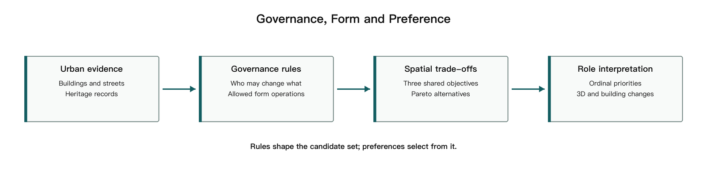
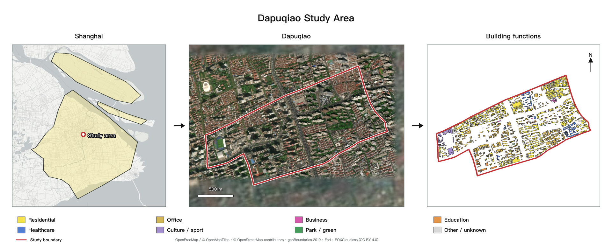
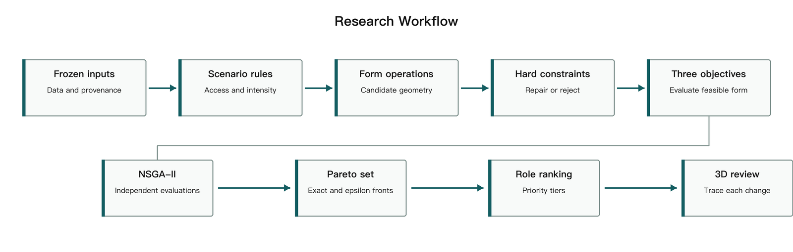
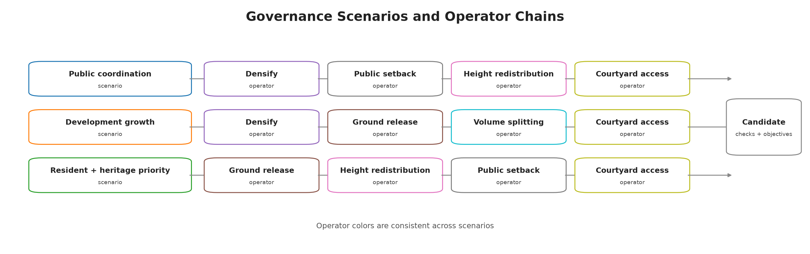

# 从利益相关者权力到城市形态：上海打浦桥城市更新的多目标生成与事后偏好框架

## 1. 摘要

历史街区更新是延续城市历史文脉、改善居民生活条件和激发既有空间活力的重要途径。这一过程需要协调遗产保护、居住改善与开发利用中的多方诉求。各方诉求如何转化为建筑改造权限，并进一步影响街区形态，是参与式规划中的关键问题。以上海打浦桥为例，本研究建立交互式形态生成与评价框架，通过治理情景（governance scenario）组合设定可改动对象、操作权限和干预强度，将公共协调、开发增长、居民与遗产优先三种更新思路落实为可执行规则。程序从现状建筑出发生成方案，检查保护与空间控制条件，并比较住宅受影响范围、新增建筑面积和临街地面释放潜力。方案生成后，再依据居民、开发实施和公共规划三种视角选择代表方案，展示逐栋建筑的变化。结果表明，治理情景通过限定可改动对象和操作方式，改变了增建容量、住宅干预与临街地面释放之间的取舍。相近的增建量可以对应不同的住宅改动规模与地面释放结果；不同角色关注的目标不同，因而会从同一组方案中选出不同结果。本文的核心创新在于，将利益主体、治理规则与空间权利转译为可执行的形态操作与约束，使不同利益分配逻辑及其对应的城市形态结果可计算、可比较、可追溯。该框架以规则驱动的方式将主体类别、操作权限与形态结果连接起来，并通过逐栋记录和交互式展示支持方案核查。本文将平台定位为可审计的研究原型。

**关键词：** 存量城市更新；遗产保护；多目标优化；利益相关者；参与式规划

## 2. 引言

历史街区更新需要同时处理建筑保护、居住改善和开发利用。增加开发容量可能涉及既有住宅的改动，释放地面空间也可能影响原有经营和日常生活。因此，方案评价既涉及空间利用效率，也涉及收益与代价在不同主体之间的分配。田子坊的实地研究将空间演变与政府、商户等行动者的权力关系联系起来，表明空间使用和改造权限是理解街区变化的重要线索（Wang & Zhou, 2022）。本文据此关注利益相关者权力在模型中的具体表达：哪些对象可以改动、允许怎样改动，以及不同主体如何选择方案。

计算设计为探索和比较更新方案提供了工具。SIMForms 将形态生成、指标评价和可视化结合起来，场地适应布局研究则将场地条件与用户配置纳入生成规则（Zhang et al., 2024；Wang et al., 2024）。多目标优化（multi-objective optimization）同时考察多个相互制约的目标，并保留各有得失的方案。如果一个方案在所有目标上均不差于另一方案，且至少一项目标更好，便称其支配（dominance）另一方案。由未被其他候选方案支配的方案构成的帕累托解集（Pareto set），能够呈现增建、居住影响与地面空间释放之间的取舍（Deb et al., 2002）。对历史街区而言，生成过程还需要明确建筑改动权限和保护要求，使方案探索与当地的更新条件相联系。

参与式遗产规划通过共同设计和共同决策，让参与者介入方案修改与选择（Leong & Janssen, 2022）。Kaim 等（2020）在土地利用优化中采用事后偏好（a posteriori preferences），即先生成具有不同目标取舍的方案，再根据利益相关者的偏好进行选择。这些研究引出本文的核心问题：如何在同一流程中表达生成前的操作权限和生成后的选择偏好，并追踪两者对应的空间后果？操作权限决定方案的可生成范围，选择偏好则决定参与者在这一范围内关注哪些结果。

本文以上海打浦桥为例，将三种治理情景转化为建筑改动规则，在共同目标下分别搜索方案，再依据不同角色的目标优先顺序选择代表方案。研究同时设置直接调整建筑高度和占地的参数基线（parametric baseline），作为对照方法。两类方法使用相同的城市数据、评价目标和共同约束，比较其方案范围、住宅改动和地面释放结果。研究的贡献是将“谁能改、如何改、如何选”落实为可执行、可检查的计算过程，并通过逐栋变化记录与三维展示，将总体指标连接到具体空间（图 1）。

**图 1.** 从城市数据、治理情景、形态生成和共同评价，到角色选择与空间核查的完整研究流程。每种情景各自生成帕累托方案集，每个角色均可对其排序。

## 3. 研究对象与数据

### 3.1 打浦桥的保护与更新需求

本研究选取上海打浦桥既有街区，重点关注田子坊及周边地区。田子坊的石库门里弄和旧厂房构成了街区的历史风貌，也承载着居住、商业经营和文化活动。《黄浦区田子坊地区综合管理办法》要求在保护特色建筑、活化旧厂房的同时，改善社区设施、保障房屋安全并协调商居关系（黄浦区人民政府，2023）。这些要求共同构成街区更新的治理背景。

在这样的街区中，同一项增建或地面空间释放操作，作用于住宅、商业建筑和保护建筑时，会面临不同限制，并影响不同使用者。研究因此将建筑的保护状态和主体类别纳入模型，以比较不同操作权限如何改变建筑干预的位置、方式和规模。

### 3.2 现状模型与更新单元

研究整合建筑轮廓、高度、用途、街网及保护建筑资料，建立包含 1,370 栋建筑的现状模型。道路围合形成 38 个更新单元（renewal units），作为组织形态操作和检查空间控制条件的基本范围。各单元配置相应的控制参数，建筑通过稳定标识与单元关联；未能稳定匹配的 32 栋建筑在模拟中保持现状。面积和距离统一采用投影坐标计算。

保护建筑依据黄浦区官方记录与现状建筑轮廓进行匹配。已匹配的 21 个建筑轮廓在模型中保持不变；另有 4 条记录因历史范围或现状对应关系待核验，保留在审查资料中。实验固定使用同一版本的输入数据，以保证不同方法和情景之间的可比性。

图 2 从左至右展示研究区在上海的位置、研究范围的卫星影像和建筑用途分布。用途分类依据研究数据，未匹配对象归为“其他／未知”。

**图 2.** 研究区位置、范围与建筑用途

## 4. 方法

### 4.1 总体流程

框架将更新方案的形成分为生成与选择两个阶段（图 3）。生成阶段从现状模型出发，依据治理情景确定可改动建筑及其操作范围，生成候选方案；通过约束检查后，计算三个共同目标，并保留具有不同取舍的帕累托方案。选择阶段根据各角色的目标优先顺序排列方案，提取代表结果，再通过三维视图和逐栋记录检查其空间变化。

各情景独立搜索，共用同一套评价目标。这样既能观察每种治理设定内部的方案取舍，也能比较不同设定产生的空间结果。角色偏好在搜索结束后应用，参与者可以在已有解集中切换评价视角，查看同一组方案为何会得到不同排序。

**图 3.** 方案生成与选择流程。三种情景分别设定建筑操作权限，共用约束和三个评价目标；每组帕累托方案再供角色排序。

### 4.2 治理情景与形态规则

模型以主体标签（stakeholder labels）标记建筑在情景规则中对应的主体类别，并结合保护状态确定操作权限。三个治理情景分别体现公共协调、开发增长以及居民与遗产优先的更新思路，通过可改动对象、操作类型、干预强度和最大改动范围的组合形成差异（表 1）。这些组合是用于比较更新策略的研究设定。

| 情景 | 操作重点 | 主要限制 |
|---|---|---|
| 公共协调 | 开发主体有限增建、释放地面和高度退让；公共资产沿街退界；居民院落通行改善 | 保护建筑及主体类别不明的建筑保持现状 |
| 开发增长 | 开发主体增建、释放地面和大体量拆分 | 居民住宅仅允许低强度通行改善；保护建筑及主体类别不明的建筑保持现状 |
| 居民与遗产优先 | 开发主体释放地面或转移高度；公共资产与居民住宅进行低强度改善 | 限制住宅的强形态干预；保护建筑及主体类别不明的建筑保持现状 |

**表 1.** 三种治理情景的操作重点与限制

操作权限通过形态算子（morphological operators）执行。每个算子是一条改变建筑高度、占地或体量的计算规则，包含适用对象、变化方式和操作强度。六种算子覆盖增建、占地收缩、体量拆分、高度调整以及通行空间改善（表 2）。例如，释放地面算子先收缩建筑占地，再在限高和容量允许的范围内增加高度，以补偿部分建筑面积；同一操作由此可能同时影响地面空间与周边住宅。

| 形态算子 | 建筑变化 | 主要控制条件 |
|---|---|---|
| 合规增建（densification） | 保持占地，增加建筑高度 | 最大增高比例为 30%，同时受限高和单元剩余容量约束 |
| 释放地面（ground release） | 收缩占地，并尝试通过增高补偿建筑面积 | 最大占地收缩比例为 25%，补偿高度受限高约束 |
| 大体量拆分（volume splitting） | 在建筑中部切出间隙，并尝试增加高度补偿面积 | 适用于占地至少 300 m² 的建筑，间隙随操作强度变化 |
| 敏感对象退让（height redistribution） | 在同一单元内降低住宅及遗产附近建筑的高度，并向较远处转移 | 调整后仍需满足限高及单元容量约束 |
| 公共资产浅退界（public-asset setback） | 收缩公共资产建筑的临街占地，保持高度 | 沿街最多退让 4 m |
| 居民院落通行改善（courtyard access improvement） | 从临街侧向院落切出候选通道，保持高度 | 通道最宽 3 m |

**表 2.** 六种形态算子的变化方式与控制条件；实际变化由操作强度、原始轮廓和约束余量共同确定。

**图 4.** 治理情景与形态算子链。箭头表示情景规则中算子的主要执行顺序，实际搜索仍会根据单元条件和约束余量调整操作强度。

生成后的方案须满足硬约束（hard constraints），即决定方案能否进入后续比较的必要条件。检查涵盖几何有效性、研究边界、保护对象不变、限高、单元容积率、建筑覆盖率、住宅保留、新增重叠和最大改动范围。其中，容积率（floor area ratio，FAR）为单元内总建筑面积与单元面积之比，建筑覆盖率（building coverage ratio）为建筑占地与单元面积之比。前八项检查由各方法共用，最大改动范围及操作权限随情景设定。程序先依据约束余量调整操作强度，再统一检查候选方案，淘汰仍违反条件的结果。每次操作均保存建筑编号、所属单元、操作类型、强度及前后属性，供后续追踪。

### 4.3 三个共同评价目标

三个目标分别描述住宅受影响的范围、新增建筑面积和临街地面释放潜力。为便于跨方案比较，各指标均按相应的基准面积归一化。总建筑面积（gross floor area，GFA）用于计算住宅规模及建筑面积变化。

**居住影响暴露（residential impact exposure）**衡量可能受到形态变化影响的住宅建筑面积比例，取值越低越好。模型将直接发生改动的住宅，以及与增高、拆分或退台建筑处于同一更新单元的住宅，计入受影响范围：

\[
f_1 = \frac{\sum_{i \in R,\,i\ exposed} GFA_i^{base}}{\sum_{i \in R} GFA_i^{base}}
\]

其中，\(R\) 为住宅建筑集合，\(GFA_i^{base}\) 为建筑 \(i\) 的现状总建筑面积，\(exposed\) 表示满足上述条件。以更新单元识别间接影响，可以将干预周边住宅纳入评价；因此，直接改动的住宅较少时，暴露值仍可能较高。

**正向增建量（positive floor-area addition）**累计各建筑增加的建筑面积，并除以研究区面积，取值越高越好：

\[
f_2 = \frac{\sum_i \max(0, GFA_i^{proposal}-GFA_i^{base})}{A_{site}}
\]

其中，\(GFA_i^{proposal}\) 为方案总建筑面积，\(A_{site}\) 为研究区面积。该指标反映方案提供新增容量的能力。结果分析同时报告净建筑面积变化，即增加量与减少量的合计，以说明新增容量是否伴随其他位置的拆减。

**临街地面释放潜力（street-adjacent ground-release potential）**衡量建筑占地收缩后，在道路附近形成的地面空间，取值越高越好：

\[
f_3 = \frac{Area[(Footprint_{base}-Footprint_{proposal}) \cap StreetBuffer_{5m}]}{A_{site}}
\]

其中，\(Footprint\) 为建筑占地范围，\(StreetBuffer_{5m}\) 为道路两侧的 5 m 缓冲范围。指标提取现状占地与方案占地之差，再计算其中落入道路缓冲区的面积，因而侧重反映与街道相邻的空间释放机会。

### 4.4 多目标搜索与角色选择

研究采用非支配排序遗传算法 II（Non-dominated Sorting Genetic Algorithm II，NSGA-II）搜索方案（Deb et al., 2002）。算法从一组候选方案出发，通过反复生成、评价和筛选，逐步保留具有不同目标取舍的结果。每个候选都经过情景操作、约束检查和三目标计算；现状方案作为共同参照。搜索结束后，采用容差阈值（epsilon tolerance）合并指标差异很小的方案，使解集更便于比较。

角色选择采用按优先顺序逐项比较的排序方式。当一项目标的差异处于容差范围内时，继续比较下一项目标。三种角色的比较顺序如下：

| 角色 | 第 1 优先级 | 第 2 优先级 | 第 3 优先级 |
|---|---|---|---|
| 居民 | 居住影响暴露（越低越好） | 正向增建量（越高越好） | 临街地面释放（越高越好） |
| 开发实施 | 正向增建量（越高越好） | 临街地面释放（越高越好） | 居住影响暴露（越低越好） |
| 公共规划 | 临街地面释放（越高越好） | 居住影响暴露（越低越好） | 正向增建量（越高越好） |

**表 3.** 三种角色的逐级目标排序。目标差异小于对应的 ε 容差时，进入下一优先级比较。优先顺序借鉴事后偏好研究（Kaim et al., 2020）。

框架还提供兼顾各角色的折中方案：先记录每个方案在不同角色排序中的名次，再选出其中最差名次最靠前的方案。这一选择方式优先改善方案在最不利角色排序中的位置，为多方比较提供共同起点。

### 4.5 实验设计

实验比较参数基线（Parametric Baseline，BL）与三个治理情景：公共协调（PC）、开发增长（DG）和居民与遗产优先（RH）。BL 通过高度倍率 1.00–1.30 和占地保留比例 0.75–1.00 调整建筑；治理情景采用对象权限和形态操作。四组共用输入数据、三个目标和共同约束：限高 36 m、单元容积率 3.0、覆盖率 0.60、住宅总建筑面积最低保留 0.80。

每组采用 40 个个体的种群、50 个计划代数，以 10 个相同的随机种子配对运行；每次运行固定 2,000 次原始评价，保存输入、参数、逐栋变化和结果记录。超体积使用四组共同归一化和共同参考点，配对比较报告中位数、范围、方向一致的种子数和 Holm 校正结果。

搜索前沿记录四组方法在固定预算下实际找到的 Pareto 方案。容量探针在相同决策空间和约束下，逐单元比较可增容操作，按增益累加，再用剩余预算做换入搜索，只测量权限表的容量。E1 为每个治理情景随机生成权限表，保留各算子可修改建筑的数量和总建筑面积，但不保留主体标签，并按更新单元分层抽样。E2 统计被修改建筑的主体类别和实际算子；E3 统计各约束的生效次数；E4/E5 检查角色排序、暴露尺度和共同包络；E6 在相同净增建和相同居住扰动下比较各情景。

匹配净增建时，在目标净增建的窄带内统计居住暴露、临街释放和建筑改动数量；匹配居住扰动时，在同一暴露上限内统计最大净增建和临街释放。标签由用途和建筑属性推断，标签敏感性作为补充分析。

### 4.7 交互平台

平台将情景选择、角色选择和方案探索组织为连续的操作步骤。用户选择情景后，可在目标散点图中查看方案取舍，选择角色后查看对应排序，再点击方案联动显示三维形态和方案指标；逐栋记录在导出结果中呈现操作前后的高度、占地与建筑面积，使总体指标能够追溯到具体改动。

设置面板允许调整情景参数并重新计算。每次运行独立保存参数与结果，完成后刷新方案及三维视图。用户由此可以检查某项权限或强度变化如何影响可选方案，并据此继续修订更新设定。

平台截图作为补充材料，用于说明操作界面和评估任务。
# 5. 结果

## 5.1 主实验

四组方法均完成 4 × 10 个方法—种子组合（40/40）。每次运行固定 2,000 次原始评价，不为凑够有效形态补跑；有效独立评价数为 1,309–1,956。四组在同一输入、同一目标、同一共同包络（36 m / FAR 3.0 / 覆盖率 0.60 / 住宅保留 0.80）、同一种子集下运行。

**表 5。** E0 主实验汇总（10 个种子的范围，括号内为中位数）。

| 方法 | 有效评价 | 可行率 | Pareto 数量 | 超体积 | 前沿最大净增建 | 临街释放中位数 |
|---|---:|---:|---:|---:|---:|---:|
| BL | 1,930–1,956 | 0.826–0.915（0.895） | 93–175 | 0.792–0.866（0.831） | 6.57–9.33% | 1.379% |
| PC | 1,478–1,571 | 0.930–0.983（0.968） | 7–25 | 0.227–0.335（0.315） | 0.59–0.79% | 0.379% |
| DG | 1,521–1,628 | 0.915–0.992（0.972） | 4–19 | 0.194–0.250（0.231） | 1.11–1.43% | 0.231% |
| RH | 1,309–1,471 | 0.900–0.971（0.954） | 3–13 | 0.228–0.327（0.298） | −0.06 至 −0.02% | 0.349% |

## 5.2 公平比较

在正式 E0（10 seed、2,000 次）上做匹配净增建比较，并在本地 1,000 次预算、3 seed 上做匹配扰动与上限比较（记录 §12）。

**表 8。** 相同净增建下的居住暴露：最小值 / 匹配候选均值（正式 E0，10 seed 均值）。

| 目标净增建 | PC | DG | BL |
|---|---:|---:|---:|
| 0.2% | 3.53 / 11.80 | 4.41 / 19.21 | unreachable |
| 0.4% | 6.57 / 11.13 | 7.61 / 21.23 | unreachable |
| 0.6% | 6.36 / 9.33 | 9.27 / 20.68 | unreachable |

**表 9。** 居住暴露上限下的最大净增建（正式 E0，10 seed）。

| 暴露上限 | PC | DG | RH |
|---|---:|---:|
| ≤0% | 0.06% | 0.04% | 0.00% |
| ≤5% | 0.16% | 0.14% | 0.00% |
| ≤10% | 0.69% | 1.23% | 0.00% |
| ≤20% | 0.70% | 1.23% | 0.00% |
| ≤30% | 0.70% | 1.23% | 0.00% |

## 5.3 操作分布

**表 10。** 被改建筑的主体构成（候选级，320 次套件，3 seed）。

| 方法 | 改建筑/候选 | 改单元/候选 | 居民 | 开发 | 公共资产 |
|---|---:|---:|---:|---:|---:|
| BL | 381.2 | 13.5 | 58.5% | 28.0% | 13.5% |
| DG | 204.1 | 9.9 | 29.1% | 70.9% | 0.0% |
| PC | 126.5 | 8.0 | 32.3% | 42.9% | 24.8% |
| RH | 96.9 | 6.2 | 30.5% | 45.6% | 23.9% |

## 5.4 约束活动

**表 11。** 约束触发次数（正式 E0，10 seed 合计）。

| 方法 | 候选数 | 限高降强度 | 足迹下限降强度 | FAR 降强度 | FAR 淘汰 | 改动范围淘汰 | 住宅保留 |
|---|---:|---:|---:|---:|---:|---:|---:|
| BL | 19,452 | 19,428 | 0 | 12,345 | 2,377 | 0 | **0** |
| PC | 15,148 | 14,265 | 10,985 | 0 | 0 | 545 | **0** |
| DG | 15,635 | 15,454 | 5,399 | 0 | 0 | 527 | **0** |
| RH | 13,841 | 10,151 | 10,860 | 0 | 0 | 710 | **0** |

正式 10 个种子的匹配结果已完成；RH 在 0.2% 以上净增建档没有可行候选，写作中保留 unreachable，不做插值。BL 合并前沿的逐种子支配统计在同一批 E0 候选上计算，并与图 3 一并报告。

## 5.5 平台专业评估

平台评估采用小规模结构化任务。3–5 位具有规划、建筑、遗产保护或开发经验的参与者各操作平台约 15 分钟，依次比较 BL、PC、DG、RH，在一个角色视角下选择方案并说明理由。系统记录情景切换、角色切换、方案查看、停留时间和导出操作；参与者完成 4 个简短问题和 1 个开放问题。

评估结果填写参与者数量、任务完成情况、首次读懂主体权限和指标取舍所需时间，以及反复出现的改进意见。该评估用于检查“谁可以改什么、谁承担什么代价”是否能够被专业使用者读懂。

## 6. 讨论

E0 显示，BL 的参数空间覆盖更宽，治理情景的可达范围集中在较小的净增建区间。E1 显示，归属、改动范围、强度和共同包络按层次影响容量：归属决定可用建筑存量，范围决定可扩展单元，强度和 FAR 决定同一批建筑能够形成的容量。

E2 把差异落到建筑和算子：PC 更多使用公共空间重构，DG 更多使用增建和体量拆分，RH 的操作集合不包含增建与拆分。权限因此改变了被修改建筑的主体构成，以及容量、住宅暴露和临街释放之间的交换方式。E3 显示，限高、足迹下限、FAR 和改动范围是主要活动约束。

E6 将比较转为相同收益或相同代价下的结果。正式结果显示，PC 和 DG 在相同净增建档位均有候选；RH 只在 0.0% 档有候选。公平比较以这些匹配结果为依据。

# 7. 结论

本文把城市更新中的主体类别、建筑改造权限和方案偏好放入同一套可重跑的生成流程。BL、PC、DG、RH 在共同目标和约束下形成不同的可达范围；E1、E2、E3 分别从权限、建筑主体和约束活动解释这种差异；公平比较进一步在相同净增建或相同居住扰动下比较各情景的结果。平台把这些关系连接到建筑级记录和三维方案，供专业参与者核查。

## 图表安排

正文保留五组图：

- **F1**：研究区、建筑用途、主体标签、遗产冻结和未匹配建筑；
- **F2**：前提、权限表、形态算子、共同约束、目标和角色选择流程；
- **F3**：BL、PC、DG、RH 的共同前沿，并标出不被 BL 合并前沿支配的治理情景解；
- **F4**：PC、DG、RH 与权限匹配零模型的超体积和匹配暴露比较；
- **F5**：一个情景中三个角色首选方案的逐栋差异。

平台截图、收敛曲线、标签与暴露尺度敏感性、约束活动明细和 E6 完整匹配表放入补充材料。
