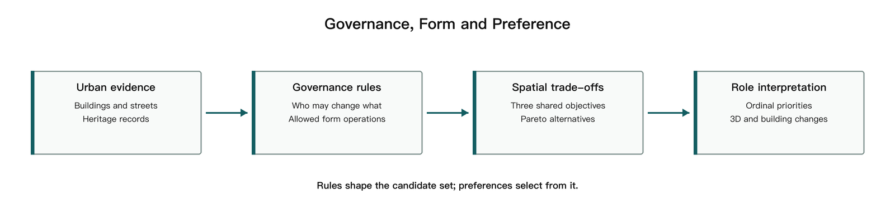
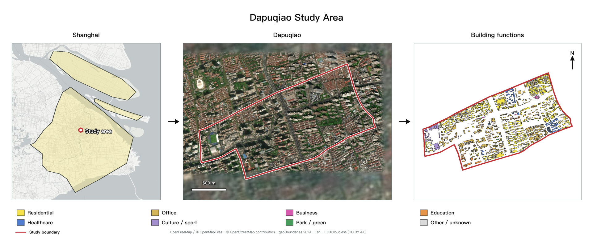
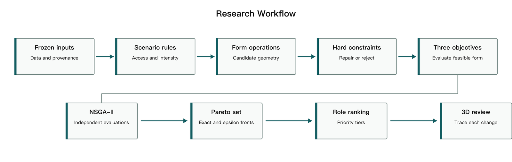
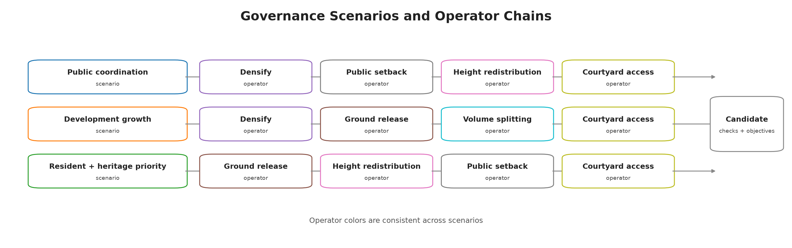
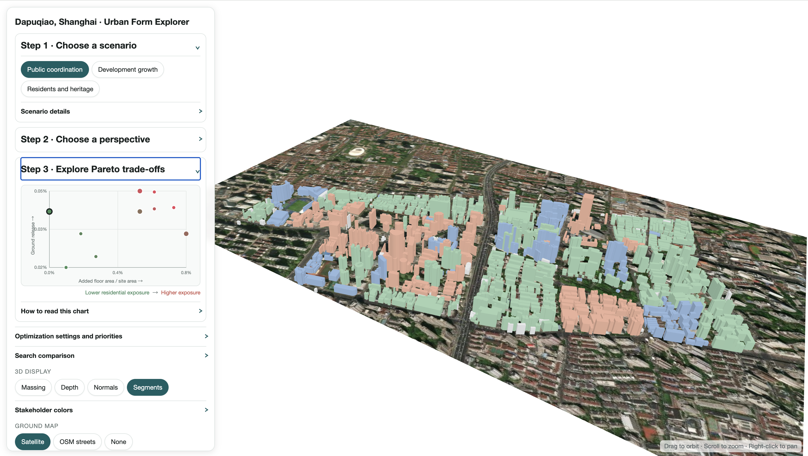

# 从利益相关者权力到城市形态：上海打浦桥城市更新的多目标生成与事后偏好框架

## 1. 摘要

历史街区更新是延续城市历史文脉、改善居民生活条件和激发既有空间活力的重要途径。这一过程需要协调遗产保护、居住改善与开发利用中的多方诉求。各方诉求如何转化为建筑改造权限，并进一步影响街区形态，是参与式规划中的关键问题。以上海打浦桥为例，本研究建立交互式形态生成与评价框架，通过治理情景（governance scenario）组合设定可改动对象、操作权限和干预强度，将公共协调、开发增长、居民与遗产优先三种更新思路落实为可执行规则。程序从现状建筑出发生成方案，检查保护与空间控制条件，并比较住宅受影响范围、新增建筑面积和临街地面释放潜力。方案生成后，再依据居民、开发实施和公共规划三种视角选择代表方案，展示逐栋建筑的变化。结果表明，治理情景通过限定可改动对象和操作方式，改变了增建容量、住宅干预与临街地面释放之间的取舍。相近的增建量可以对应不同的住宅改动规模与地面释放结果；不同角色关注的目标不同，因而会从同一组方案中选出不同结果。本文的核心创新在于，将利益主体、治理规则与空间权利转译为可执行的形态操作与约束，使不同利益分配逻辑及其对应的城市形态结果可计算、可比较、可追溯。该框架以规则驱动的方式将主体类别、操作权限与形态结果连接起来，并通过逐栋记录和交互式展示支持方案核查。本文将平台定位为可审计的研究原型。

**关键词：** 存量城市更新；遗产保护；多目标优化；利益相关者；参与式规划

## 2. 引言

历史街区更新需要同时处理建筑保护、居住改善和开发利用。增加开发容量可能涉及既有住宅的改动，释放地面空间也可能影响原有经营和日常生活。因此，方案评价既涉及空间利用效率，也涉及收益与代价在不同主体之间的分配。田子坊的实地研究将空间演变与政府、商户等行动者的权力关系联系起来，表明空间使用和改造权限是理解街区变化的重要线索（Wang & Zhou, 2022）。本文据此关注利益相关者权力在模型中的具体表达：哪些对象可以改动、允许怎样改动，以及不同主体如何选择方案。

计算设计为探索和比较更新方案提供了工具。SIMForms 将形态生成、指标评价和可视化结合起来，场地适应布局研究则将场地条件与用户配置纳入生成规则（Zhang et al., 2024；Wang et al., 2024）。多目标优化（multi-objective optimization）同时考察多个相互制约的目标，并保留各有得失的方案。如果一个方案在所有目标上均不差于另一方案，且至少一项目标更好，便称其支配（dominance）另一方案。由未被其他候选方案支配的方案构成的帕累托解集（Pareto set），能够呈现增建、居住影响与地面空间释放之间的取舍（Deb et al., 2002）。对历史街区而言，生成过程还需要明确建筑改动权限和保护要求，使方案探索与当地的更新条件相联系。

参与式遗产规划通过共同设计和共同决策，让参与者介入方案修改与选择（Leong & Janssen, 2022）。Kaim 等（2020）在土地利用优化中采用事后偏好（a posteriori preferences），即先生成具有不同目标取舍的方案，再根据利益相关者的偏好进行选择。这些研究引出本文的核心问题：如何在同一流程中表达生成前的操作权限和生成后的选择偏好，并追踪两者对应的空间后果？操作权限决定方案的可生成范围，选择偏好则决定参与者在这一范围内关注哪些结果。

本文以上海打浦桥为例，将三种治理情景转化为建筑改动规则，在共同目标下分别搜索方案，再依据不同角色的目标优先顺序选择代表方案。研究同时设置直接调整建筑高度和占地的参数基线（parametric baseline），作为对照方法。两类方法使用相同的城市数据、评价目标和共同约束，比较其方案范围、住宅改动和地面释放结果。研究的贡献是将“谁能改、如何改、如何选”落实为可执行、可检查的计算过程，并通过逐栋变化记录与三维展示，将总体指标连接到具体空间（图 1）。

**图 1.** 从城市数据、治理情景、形态生成和共同评价，到角色选择与空间核查的完整研究流程。每种情景各自生成帕累托方案集，每个角色均可对其排序。

## 3. 研究对象与数据

### 3.1 打浦桥的保护与更新需求

本研究选取上海打浦桥既有街区，重点关注田子坊及周边地区。田子坊的石库门里弄和旧厂房构成了街区的历史风貌，也承载着居住、商业经营和文化活动。《黄浦区田子坊地区综合管理办法》要求在保护特色建筑、活化旧厂房的同时，改善社区设施、保障房屋安全并协调商居关系（黄浦区人民政府，2023）。这些要求共同构成街区更新的治理背景。

在这样的街区中，同一项增建或地面空间释放操作，作用于住宅、商业建筑和保护建筑时，会面临不同限制，并影响不同使用者。研究因此将建筑的保护状态和主体类别纳入模型，以比较不同操作权限如何改变建筑干预的位置、方式和规模。

### 3.2 现状模型与更新单元

研究整合建筑轮廓、高度、用途、街网及保护建筑资料，建立包含 1,370 栋建筑的现状模型。道路围合形成 38 个更新单元（renewal units），作为组织形态操作和检查空间控制条件的基本范围。各单元配置相应的控制参数，建筑通过稳定标识与单元关联；未能稳定匹配的 32 栋建筑在模拟中保持现状。面积和距离统一采用投影坐标计算。

保护建筑依据黄浦区官方记录与现状建筑轮廓进行匹配。已匹配的 21 个建筑轮廓在模型中保持不变；另有 4 条记录因历史范围或现状对应关系待核验，保留在审查资料中。实验固定使用同一版本的输入数据，以保证不同方法和情景之间的可比性。

图 2 从左至右展示研究区在上海的位置、研究范围的卫星影像和建筑用途分布。用途分类依据研究数据，未匹配对象归为“其他／未知”。

**图 2.** 研究区位置、范围与建筑用途

## 4. 方法

### 4.1 总体流程

框架将更新方案的形成分为生成与选择两个阶段（图 3）。生成阶段从现状模型出发，依据治理情景确定可改动建筑及其操作范围，生成候选方案；通过约束检查后，计算三个共同目标，并保留具有不同取舍的帕累托方案。选择阶段根据各角色的目标优先顺序排列方案，提取代表结果，再通过三维视图和逐栋记录检查其空间变化。

各情景独立搜索，共用同一套评价目标。这样既能观察每种治理设定内部的方案取舍，也能比较不同设定产生的空间结果。角色偏好在搜索结束后应用，参与者可以在已有解集中切换评价视角，查看同一组方案为何会得到不同排序。

**图 3.** 方案生成与选择流程。三种情景分别设定建筑操作权限，共用约束和三个评价目标；每组帕累托方案再供角色排序。

### 4.2 治理情景与形态规则

模型以主体标签（stakeholder labels）标记建筑在情景规则中对应的主体类别，并结合保护状态确定操作权限。三个治理情景分别体现公共协调、开发增长以及居民与遗产优先的更新思路，通过可改动对象、操作类型、干预强度和最大改动范围的组合形成差异（表 1）。这些组合是用于比较更新策略的研究设定。

| 情景 | 操作重点 | 主要限制 |
|---|---|---|
| 公共协调 | 开发主体有限增建、释放地面和高度退让；公共资产沿街退界；居民院落通行改善 | 保护建筑及主体类别不明的建筑保持现状 |
| 开发增长 | 开发主体增建、释放地面和大体量拆分 | 居民住宅仅允许低强度通行改善；保护建筑及主体类别不明的建筑保持现状 |
| 居民与遗产优先 | 开发主体释放地面或转移高度；公共资产与居民住宅进行低强度改善 | 限制住宅的强形态干预；保护建筑及主体类别不明的建筑保持现状 |

**表 1.** 三种治理情景的操作重点与限制

操作权限通过形态算子（morphological operators）执行。每个算子是一条改变建筑高度、占地或体量的计算规则，包含适用对象、变化方式和操作强度。六种算子覆盖增建、占地收缩、体量拆分、高度调整以及通行空间改善（表 2）。例如，释放地面算子先收缩建筑占地，再在限高和容量允许的范围内增加高度，以补偿部分建筑面积；同一操作由此可能同时影响地面空间与周边住宅。

| 形态算子 | 建筑变化 | 主要控制条件 |
|---|---|---|
| 合规增建（densification） | 保持占地，增加建筑高度 | 最大增高比例为 30%，同时受限高和单元剩余容量约束 |
| 释放地面（ground release） | 收缩占地，并尝试通过增高补偿建筑面积 | 最大占地收缩比例为 25%，补偿高度受限高约束 |
| 大体量拆分（volume splitting） | 在建筑中部切出间隙，并尝试增加高度补偿面积 | 适用于占地至少 300 m² 的建筑，间隙随操作强度变化 |
| 敏感对象退让（height redistribution） | 在同一单元内降低住宅及遗产附近建筑的高度，并向较远处转移 | 调整后仍需满足限高及单元容量约束 |
| 公共资产浅退界（public-asset setback） | 收缩公共资产建筑的临街占地，保持高度 | 沿街最多退让 4 m |
| 居民院落通行改善（courtyard access improvement） | 从临街侧向院落切出候选通道，保持高度 | 通道最宽 3 m |

**表 2.** 六种形态算子的变化方式与控制条件；实际变化由操作强度、原始轮廓和约束余量共同确定。

**图 4.** 治理情景与形态算子链。箭头表示情景规则中算子的主要执行顺序，实际搜索仍会根据单元条件和约束余量调整操作强度。

生成后的方案须满足硬约束（hard constraints），即决定方案能否进入后续比较的必要条件。检查涵盖几何有效性、研究边界、保护对象不变、限高、单元容积率、建筑覆盖率、住宅保留、新增重叠和最大改动范围。其中，容积率（floor area ratio，FAR）为单元内总建筑面积与单元面积之比，建筑覆盖率（building coverage ratio）为建筑占地与单元面积之比。前八项检查由各方法共用，最大改动范围及操作权限随情景设定。程序先依据约束余量调整操作强度，再统一检查候选方案，淘汰仍违反条件的结果。每次操作均保存建筑编号、所属单元、操作类型、强度及前后属性，供后续追踪。

### 4.3 三个共同评价目标

三个目标分别描述住宅受影响的范围、新增建筑面积和临街地面释放潜力。为便于跨方案比较，各指标均按相应的基准面积归一化。总建筑面积（gross floor area，GFA）用于计算住宅规模及建筑面积变化。

**居住影响暴露（residential impact exposure）**衡量可能受到形态变化影响的住宅建筑面积比例，取值越低越好。模型将直接发生改动的住宅，以及与增高、拆分或退台建筑处于同一更新单元的住宅，计入受影响范围：

\[
f_1 = \frac{\sum_{i \in R,\,i\ exposed} GFA_i^{base}}{\sum_{i \in R} GFA_i^{base}}
\]

其中，\(R\) 为住宅建筑集合，\(GFA_i^{base}\) 为建筑 \(i\) 的现状总建筑面积，\(exposed\) 表示满足上述条件。以更新单元识别间接影响，可以将干预周边住宅纳入评价；因此，直接改动的住宅较少时，暴露值仍可能较高。

**正向增建量（positive floor-area addition）**累计各建筑增加的建筑面积，并除以研究区面积，取值越高越好：

\[
f_2 = \frac{\sum_i \max(0, GFA_i^{proposal}-GFA_i^{base})}{A_{site}}
\]

其中，\(GFA_i^{proposal}\) 为方案总建筑面积，\(A_{site}\) 为研究区面积。该指标反映方案提供新增容量的能力。结果分析同时报告净建筑面积变化，即增加量与减少量的合计，以说明新增容量是否伴随其他位置的拆减。

**临街地面释放潜力（street-adjacent ground-release potential）**衡量建筑占地收缩后，在道路附近形成的地面空间，取值越高越好：

\[
f_3 = \frac{Area[(Footprint_{base}-Footprint_{proposal}) \cap StreetBuffer_{5m}]}{A_{site}}
\]

其中，\(Footprint\) 为建筑占地范围，\(StreetBuffer_{5m}\) 为道路两侧的 5 m 缓冲范围。指标提取现状占地与方案占地之差，再计算其中落入道路缓冲区的面积，因而侧重反映与街道相邻的空间释放机会。

### 4.4 多目标搜索与角色选择

研究采用非支配排序遗传算法 II（Non-dominated Sorting Genetic Algorithm II，NSGA-II）搜索方案（Deb et al., 2002）。算法从一组候选方案出发，通过反复生成、评价和筛选，逐步保留具有不同目标取舍的结果。每个候选都经过情景操作、约束检查和三目标计算；现状方案作为共同参照。搜索结束后，采用容差阈值（epsilon tolerance）合并指标差异很小的方案，使解集更便于比较。

角色选择采用按优先顺序逐项比较的排序方式。当一项目标的差异处于容差范围内时，继续比较下一项目标。三种角色的比较顺序如下：

| 角色 | 第 1 优先级 | 第 2 优先级 | 第 3 优先级 |
|---|---|---|---|
| 居民 | 居住影响暴露（越低越好） | 正向增建量（越高越好） | 临街地面释放（越高越好） |
| 开发实施 | 正向增建量（越高越好） | 临街地面释放（越高越好） | 居住影响暴露（越低越好） |
| 公共规划 | 临街地面释放（越高越好） | 居住影响暴露（越低越好） | 正向增建量（越高越好） |

**表 3.** 三种角色的逐级目标排序。目标差异小于对应的 ε 容差时，进入下一优先级比较。优先顺序借鉴事后偏好研究（Kaim et al., 2020）。

框架还提供兼顾各角色的折中方案：先记录每个方案在不同角色排序中的名次，再选出其中最差名次最靠前的方案。这一选择方式优先改善方案在最不利角色排序中的位置，为多方比较提供共同起点。

### 4.5 对照实验设计

实验比较参数基线与三个治理情景。参数基线通过高度倍率 1.00–1.30 和占地保留比例 0.75–1.00 调整建筑；治理情景采用表 1 和表 2 中的对象权限与形态操作。四组共用输入数据、三个目标和共同约束，统一设置 36 m 限高、容积率 3.0、建筑覆盖率 0.60 和住宅总建筑面积最低保留比例 0.80。

每组采用 20 个个体的种群、20 个计划代数，并以五个相同的随机种子配对运行。随机种子（random seed）控制随机过程，便于复现和对应比较。每次运行完成 400 次有效独立评价，即实际计算互不重复的候选形态；重复方案直接调用已有结果。四组共形成 20 次运行，并保存输入、参数、逐栋变化和结果记录。

分析分为三个层次：首先比较各方法的目标范围；其次选取增建量相近的方案，检查住宅改动与地面释放的差异；最后在同一情景中比较不同角色选择的空间后果。目标范围另以超体积（hypervolume）辅助评价，该指标衡量解集相对于统一参考点所覆盖的目标空间。五个种子的超体积采用双侧配对符号秩检验（Wilcoxon signed-rank test），依据配对差值的方向和排序比较两组结果；再以 Holm 校正（Holm correction）调整三次比较的 p 值，控制多重比较的误判概率。

### 4.6 交互平台

平台将情景选择、角色选择和方案探索组织为连续的操作步骤。用户选择情景后，可在目标散点图中查看方案取舍，选择角色后查看对应排序，再点击方案联动显示三维形态和建筑详情。逐栋记录呈现操作前后的高度、占地与建筑面积，使总体指标能够追溯到具体改动。

设置面板允许调整情景参数并重新计算。每次运行独立保存参数与结果，完成后刷新方案及三维视图。用户由此可以检查某项权限或强度变化如何影响可选方案，并据此继续修订更新设定。

**图 5.** 交互平台界面
#
> **稿件状态（2026-10-31）**：本稿按老师建议收束为“权限如何改变可行空间—机制如何发生—公平条件下如何比较”的主线。E0、E1、E2/E3、E5 与标签敏感性已有记录；正式远端 E6 正在运行，凡依赖正式 E6 的表格保留待回填位置，不用预览值替代。平台交互结果是探索性单 seed 重算，不与正式论文结果混用。

# 5. 结果（v6，主线整理版）

> 本文件是 `2026-10-29_打浦桥_CAADRIA_中文稿_v4_实验结构版.md` 第 5 章的替换稿。
> 写作原则：只写已经被记录验证过的数字，来源指向 `research/experiment_records/2026-10-30_dapuqiao_E0-E6_status.md` 的对应小节；
> 尚无数据的格子保留 ⟨待补⟩ 并写明原因，不用估计值填充。

## 5.0 测量口径：两种仪器，两种读法

本文报告两种互不替代的测量：

1. **搜索前沿（E0、E1 的 NSGA-II 运行）**：在固定评价预算下，四组方法各自生成的前沿。它回答“用这个预算、这台搜索器，实际找到了什么”，受预算与算法影响。
2. **容量探针（确定性贪心饱和）**：在同一决策空间与同一约束下，只最大化净建筑面积，消耗相同预算。它回答“这张权限表最多能推到多少”，用于测量权限表在当前约束下的容量。

两种测量必须同时报告，因为二者差距很大：在 320 次评价下，探针比前沿极值高 1.3–10 倍（§5.3）；在 2,000 次评价下，DG 的前沿极值为 1.11–1.43%，而 320 次探针已达 1.716%。后文分别标注前沿极值与探针容量。

匹配比较另有一个口径问题：同一批候选可以统计“匹配候选的最小暴露”，也可以统计“匹配候选的平均暴露”。两者在正式 E0 数据上分别给出 PC 3.53% / DG 4.41% 与 PC 11.80% / DG 19.21%（0.2% 净增建档）。本文同时报告两者，并在结论中说明各自含义。

## 5.1 E0 主实验的完整性与收敛

四组方法均完成 4 × 10 个方法—种子组合（40/40）。每次运行固定 2,000 次原始评价，不为凑够有效形态补跑；有效独立评价数为 1,309–1,956。四组在同一输入、同一目标、同一共同包络（36 m / FAR 3.0 / 覆盖率 0.60 / 住宅保留 0.80）、同一种子集下运行。

**表 5。** E0 主实验汇总（10 个种子的范围，括号内为中位数）。

| 方法 | 有效评价 | 可行率 | Pareto 数量 | 超体积 | 前沿最大净增建 | 临街释放中位数 |
|---|---:|---:|---:|---:|---:|---:|
| BL | 1,930–1,956 | 0.826–0.915（0.895） | 93–175 | 0.792–0.866（0.831） | 6.57–9.33% | 1.379% |
| PC | 1,478–1,571 | 0.930–0.983（0.968） | 7–25 | 0.227–0.335（0.315） | 0.59–0.79% | 0.379% |
| DG | 1,521–1,628 | 0.915–0.992（0.972） | 4–19 | 0.194–0.250（0.231） | 1.11–1.43% | 0.231% |
| RH | 1,309–1,471 | 0.900–0.971（0.954） | 3–13 | 0.228–0.327（0.298） | −0.06 至 −0.02% | 0.349% |

三点读数：

- BL 的可行率反而最低（0.895），因为它的决策空间包含会突破 FAR 的组合；PC/DG/RH 的可行率都在 0.95 以上，说明权限表把搜索限制在了更容易合规的区域。
- PC/DG/RH 的 Pareto 数量只有 3–25，而 BL 有 93–175。治理情景可达的净增建集中在 0–1.4%，目标差异在 epsilon 过滤后形成较小的前沿集合。
- 超体积保留率（相对 BL 中位数）为 PC 38%、DG 28%、RH 36%。该比例描述前沿覆盖范围。

## 5.2 可达范围与参数基线的定位

BL 覆盖的技术范围为净增建 6.57–9.33%、临街释放 1.379%（中位数）。三个治理情景把净增建压缩到 0–1.43%，同时把临街释放压到 0.23–0.38%。

BL 与治理情景对应不同的决策空间。BL 调整单元高度倍率与占地比例；治理情景以建筑级离散算子和权限表生成方案。解除归属限制后，DG 探针在 320 次评价下达到 10.45% 净增建，高于 BL 在 2,000 次评价下找到的 9.33%。表 5 与图 3 因此分别呈现参数空间和权限结构下的可达范围。

## 5.3 旋钮账本：每条治理规则分别买到了什么

E1 用 2 × 2 × 2 全因子（归属 × 算子集合 × 强度上限）加一层改动范围，共 99 次 320 次预算运行与 42 个探针（记录 §10、§11）。本节报告每个旋钮对容量和代价的独立效应。

**表 6。** 旋钮账本（PC/DG，均以 3 seed 均值为准）。

| 旋钮 | 效应量 | 机制 | 证据类型 |
|---|---|---|---|
| 归属（谁能改） | 前沿最大净增建 PC 0.599→0.821–1.342；DG 0.623→1.342–2.688；探针 PC 0.801→4.115；DG 1.716→10.450 | 只允许开发主体增建，把可增建存量限制在少数建筑；解除后可用居民存量换取容量 | 全因子 + 探针 |
| 强度上限 | 等扰动下容量 ×1.82（PC 4.115 vs DG 7.468，扰动同为 24.9%） | 同一批建筑上“一次能加多高”，0.45 与 1.0 的差别 | 探针（受控对照） |
| 改动范围 | 仅在归属解除后有效：PC +39%（4.115→5.729）、DG +40%（7.468→10.450）；归属保留时三档范围给出**同一个解** | 范围是第二道闸，前一道没开时不起作用 | 探针 |
| 算子集合 | PC/DG 容量 0 变化；RH 从 0 到 1.716%（保留标签）/ 6.337%（解除标签） | DG 的拆分不产生净增建；RH 的问题不是权限而是根本没有增容算子 | 全因子 + 探针 |

**表 7。** 因子主效应（epsilon 前沿最大净增建，百分点）。

| 情景 | 归属 | 算子集合 | 强度 | 归属×算子 |
|---|---:|---:|---:|---:|
| PC | −0.593 | +0.004 | +0.034 | −0.133 |
| DG | −1.565 | −0.536 | −0.096 | +0.494 |
| RH | +0.119 | +0.712 | 0.000 | +0.131 |

负号表示“低水位更高”。PC/DG 的归属效应为负，即移除标签后容量上升；RH 的算子效应为正，即只有补进增容算子才有容量。RH 的强度效应恒为 0，因为它的原强度表与统一表相同，设计上无对比。

**这一节显示出约束的嵌套性**：归属是总闸，范围是第二道闸，算子在 PC/DG 上几乎不构成容量约束，而 RH 的容量由算子集合决定。

## 5.4 E6 匹配比较：三把尺子与拆建机制

在正式 E0（10 seed、2,000 次）上做匹配净增建比较，并在本地 1,000 次预算、3 seed 上做匹配扰动与上限比较（记录 §12）。

**表 8。** 相同净增建下的居住暴露：最小值 / 匹配候选均值（正式 E0，10 seed 均值）。

| 目标净增建 | PC | DG | BL |
|---|---:|---:|---:|
| 0.2% | 3.53 / 11.80 | 4.41 / 19.21 | 17.82 / ⟨待补⟩ |
| 0.5% | 6.47 / 10.07 | 9.02 / 20.61 | 16.20 / ⟨待补⟩ |

**表 9。** 居住暴露上限下的最大净增建（本地 1,000 次、3 seed，PC/DG）。

| 暴露上限 | PC | DG |
|---|---:|---:|
| ≤5% | 0.15% | 0.21% |
| ≤10% | 0.66% | 1.13% |
| ≤20% | 0.66% | 1.13% |

三把尺子给出不同排序，而且可以解释：

- **均值口径**：PC 明显更低（0.2% 档 11.80 vs 19.21）。
- **最小值口径**：两者接近（3.53 vs 4.41），0.2% 档的差距从 7.4pp 缩到 0.9pp。
- **上限口径**：DG 更好（≤10% 暴露时 1.13 vs 0.66）。

机制在候选构成里：同样 0.2% 净增建，DG 平均改 196 栋建筑、总增建 13,518 m²、暴露 181 栋住宅；PC 改 99 栋、总增建 7,328 m²、暴露 103 栋（1,000 次、3 seed）。**DG 用约两倍的拆建量换取同样的净增建**：它的操作组合大量先减后补，净收益被抵消，被改建筑与住宅暴露翻倍。PC 的组合更接近“直接加”。

因此，**在同样的净增建下，DG 以约两倍的拆建量达成目标，并伴随更高的被改建筑数量与住宅暴露；PC 将同样的净增建集中在更少的建筑上。**

## 5.5 E2 行为分布：权限表改变的是谁的楼

**表 10。** 被改建筑的主体构成（候选级，320 次套件，3 seed）。

| 方法 | 改建筑/候选 | 改单元/候选 | 居民 | 开发 | 公共资产 |
|---|---:|---:|---:|---:|---:|
| BL | 381.2 | 13.5 | 58.5% | 28.0% | 13.5% |
| DG | 204.1 | 9.9 | 29.1% | 70.9% | 0.0% |
| PC | 126.5 | 8.0 | 32.3% | 42.9% | 24.8% |
| RH | 96.9 | 6.2 | 30.5% | 45.6% | 23.9% |

BL 不读主体，因此一半以上动的是居民楼；DG 的权限表里没有公共空间重构，公共资产占比为 0；PC/RH 靠公共空间重构才碰到约四分之一的公共资产。**这张表是“权限表改变的是谁的楼”的直接证据**，比超体积更能说明治理差异落在哪里。

算子层面（正式 E0，10 seed）：PC 的公共空间重构出现在 90.4% 的候选中、增建 71.7%；DG 的拆分 44.3%、增建 63.1%；RH 完全不出现增建与拆分。DG 的拆分虽然进入 44% 的候选，却不提高容量上限（表 6），说明它主要贡献临街释放而非净面积。

## 5.6 E3/E5 约束与包络：四个共同控制里只有两个真正起作用

**表 11。** 约束触发次数（正式 E0，10 seed 合计）。

| 方法 | 候选数 | 限高降强度 | 足迹下限降强度 | FAR 降强度 | FAR 淘汰 | 改动范围淘汰 | 住宅保留 |
|---|---:|---:|---:|---:|---:|---:|---:|
| BL | 19,452 | 19,428 | 0 | 12,345 | 2,377 | 0 | **0** |
| PC | 15,148 | 14,265 | 10,985 | 0 | 0 | 545 | **0** |
| DG | 15,635 | 15,454 | 5,399 | 0 | 0 | 527 | **0** |
| RH | 13,841 | 10,151 | 10,860 | 0 | 0 | 710 | **0** |

住宅保留在四组、10 个种子的全部候选里一次都没有触发；在 320 次套件的 3,014 条候选日志中同样为 0。原因是现有算子集合里没有“拆住宅”的动作：增建只会增加住宅面积，缩占地会先被限高或足迹下限夹住并补偿面积。**它目前是一条形式性约束。** 遗产冻结同理，它以“不可编辑”的先验排除实现，不会出现在违规日志里，以不可编辑先验实现。

覆盖率也从不 binding：把它从 0.50 改到 0.70，探针给出同一个解（记录 §16）。

**表 12。** 包络敏感性（探针，归属解除，800 次预算）。

| 因子 | 取值 | PC | DG | DG/PC |
|---|---:|---:|---:|---:|
| 限高 | 24 m | 2.792% | 6.358% | 2.28 |
| 限高 | 36 m | 4.115% | 10.450% | 2.54 |
| 限高 | 45 m | 4.671% | 11.495% | 2.46 |
| FAR | 2.5 | 1.744% | 2.833% | **1.62** |
| FAR | 3.0 | 4.115% | 10.450% | 2.54 |
| FAR | 3.5 | 4.140% | 12.784% | **3.09** |
| 覆盖率 | 0.50 / 0.60 / 0.70 | 4.115% | 10.450% | 2.54 |

两个结论：

1. **限高只是整体缩放**：24→45 m 使 PC +67%、DG +80%，两者比例稳定在 2.3–2.7 倍，不改变排序。
2. **FAR 是放大情景差距的旋钮**：PC 在 FAR 3.0 已接近饱和（3.0→3.5 只 +0.6%），DG 仍受 FAR 约束（+22%），因此 DG/PC 从 1.62 倍升到 3.09 倍。**共同包络不是中性背景参数，放得越松越有利于强度上限更高的情景**，必须作为敏感性维度报告。

另有一个反直觉结果：DG 在 24 m 时暴露 47.7%，高于 36 m 的 43.3%。包络收紧时，要凑出容量必须扩散到更多单元（17 个，正好触到上限 vs 13 个），暴露反而变大。

## 5.7 E4 角色选择：角色排序是并列解内的定序

**表 13。** 相邻优先级交换后的首选变化（320 次套件，3 seed）。

| 方法 | 变化/总次数 | 变化率 | 首选层并列解数（均值） |
|---|---:|---:|---:|
| PC | 10/18 | 56% | 11.7 |
| DG | 11/18 | 61% | 10.3 |
| RH | 9/18 | 50% | 6.7 |
| 合计 | 30/54 | 56% | — |

epsilon 前沿的首选层通常有 7–12 个并列解，角色排序在这些并列解之间完成选择；换一个相邻优先级，约六成情况下会换方案。角色排序作用于已生成的前沿。

## 5.8 标签误分类：容量对标签误差呈台阶式敏感

**表 14。** 随机翻转 resident↔developer 标签后的容量（探针，320 次，每档 3 次重复）。

| 情景 | 噪声 | 容量均值 | 三次范围 | 开发主体占比 | 改动单元/上限 |
|---|---:|---:|---|---:|---:|
| PC | 0% | 0.801% | 0.801–0.801 | 25.1% | 6 / 11 |
| PC | 5% | 1.229% | 1.085–1.406 | 26.9% | 11 / 11 |
| PC | 10% | 1.212% | 1.126–1.275 | 28.0% | 11 / 11 |
| DG | 0% | 1.716% | 1.716–1.716 | 25.1% | 6 / 17 |
| DG | 5% | 2.651% | 2.330–3.008 | 26.9% | 14 / 17 |
| DG | 10% | 2.694% | 2.530–2.785 | 28.0% | 17 / 17 |

开发主体占比只上升 1.8pp，PC 的容量就上升 53%。机制是单元级解锁：一个单元里多出几栋开发楼，整个单元就从“不允许增建”变成“允许增建”。5% 与 10% 噪声的差别却很小，因为此时上限已从“开发主体存量”转为“改动范围”——PC 两档都用满 11 个单元，DG 用满 17 个。

因此本文所有容量数字均应读作**基于标签 proxy 的条件值**；同时“标签误差会通过单元解锁放大容量”这一点，应写在结果之前，而不是局限里。

## 5.9 正式 E6 回填

正式远端 E6 将补充 10 seed 的匹配净增建与匹配居住扰动结果，并更新表 8、表 9 及图 3 的公平比较部分。当前稿件保留对应待补格。

## 回填清单

| 位置 | 待补内容 | 数据来源 |
|---|---|---|
| 表 8 BL 列 | 正式 10 seed 的匹配候选均值暴露 | 远端 `e0_formal_remote_20261029` 运行目录 + `analyze_dapuqiao_matching.py` |
| 表 9 | 正式 10 seed 版本 | 同上 |
| 表 14 | 误分类重复次数从 3 次提到 5 次、加入 state 误判 | 需新跑标签扰动 |
| 图 3–5 | 合并前沿、逐栋差异、角色首选 | 已有 run 目录可直接出图 |

## 附录 A：方法章节需增补的一段（4.4 之后）

> 可直接粘贴进第 4 章。

**容量探针。** 搜索前沿回答“在给定预算下找到了什么”，不回答“这张权限表最多能推到多少”。为分离两者，本文另设一个确定性探针：在同一决策空间、同一约束、同一目标函数下，先逐单元筛选可增容算子，再按单单元增益从高到低累加提交，最后用剩余预算做换入搜索，全程只最大化净建筑面积。探针消耗与前沿运行相同的原始评价预算（320 次；包络与范围敏感性用 800 次），不依赖随机种子。探针与搜索共用同一条改动范围上限（单元比例与建筑比例都执行），探针输出作为权限表容量的下界，与搜索前沿极值分开报告。

## 附录 B：讨论章节可改写的段落（6.1）

> 替换原 ⟨根据 E0、E1、E6 填写主要发现⟩。

治理权限对形态空间的作用不是“整体收紧”，而是**沿一条依赖链逐级生效**。第一级是归属：决定哪些建筑可以被增建，解除后容量提升 4–5 倍，代价是居住暴露从 9.1% 升到 24.9%–43.3%。第二级是改动范围：只有在归属解除后才有意义，因为归属保留时开发主体的存量在少数单元内就已饱和，范围三档给出同一个解。第三级是强度与包络：强度决定同一批建筑上能加多高（等暴露下 1.8 倍差），FAR 决定这套差异被放大还是压缩（DG/PC 从 1.62 倍到 3.09 倍）。

这条链有一个直接的方法论含义：**单因子消融会低估治理的作用，也会误判约束的来源。** 如果只放宽范围、不放宽归属，会得到“范围无效”的结论；如果只比较前沿极值、不比较探针，会得到“DG 容量只有 PC 的两倍”的结论，而真实差距接近四倍。本文因此同时报告前沿与探针、同时报告匹配的最小值与均值。

对规划实践的含义是：权限表买到的东西可以被逐项记账——归属买到的是“可以用谁的存量换容量”，强度买到的是“同一批楼能加多高”，范围买到的是“能扩散到几片”，FAR 买到的是“这套差异被放大多少”。这比“哪个情景综合指标更高”更适合作为协商的起点，因为每一项都能对应到具体的规则条文与具体的承担者。
