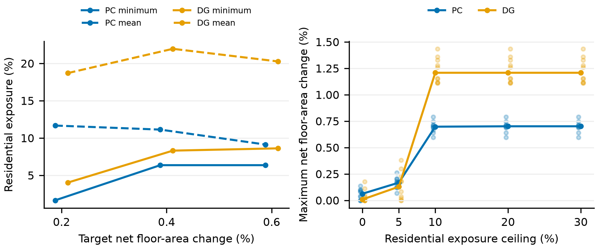
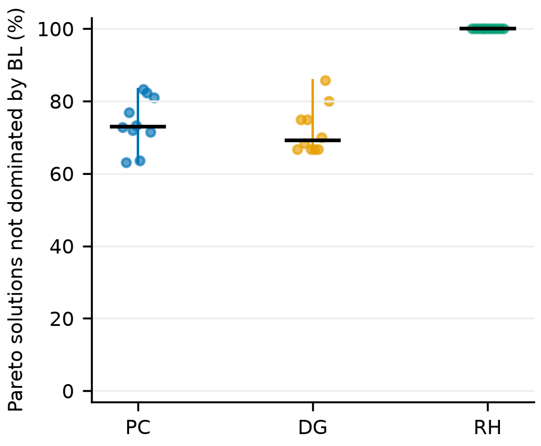
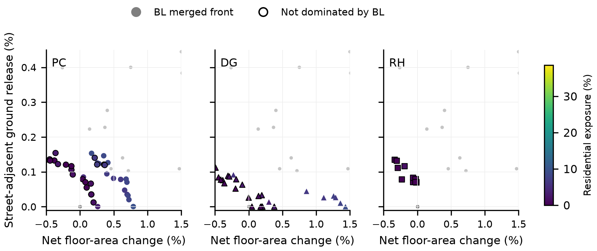

# 补充图表

**E6 匹配图。** 左图实线为各 seed 最小暴露的中位数，虚线为各 seed 匹配候选平均暴露的中位数；右图浅色点为各 seed 结果，折线为中位数。图中中位数与正文均值汇总分别标明。

**图 S4.** 每个点代表一个 seed，黑横线为中位数，竖线为最小至最大范围；分母为该 seed 导出的 Pareto 解数。

**图 S3.** 图 4 在净建筑面积变化 −0.5% 至 1.5% 区间的局部放大。各面板仍使用相同坐标和原图色阶，用于辨认正净增建附近的未支配解。

