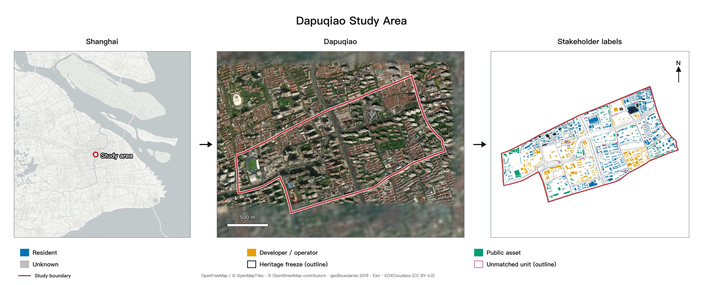
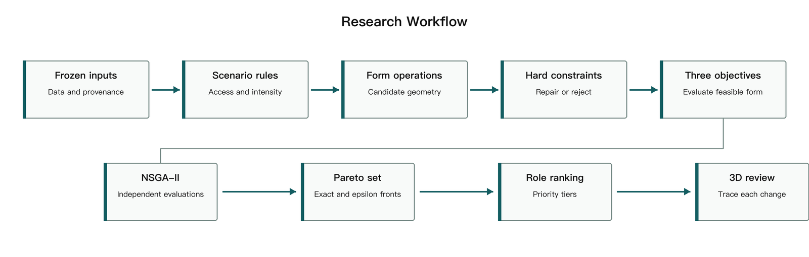
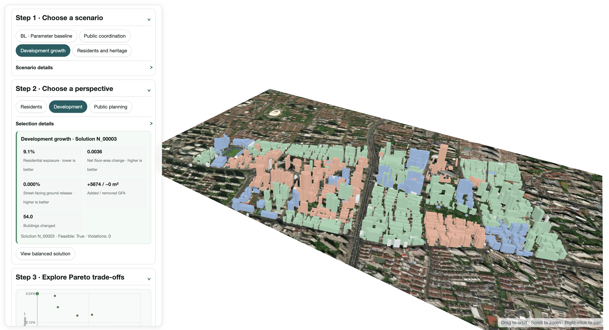
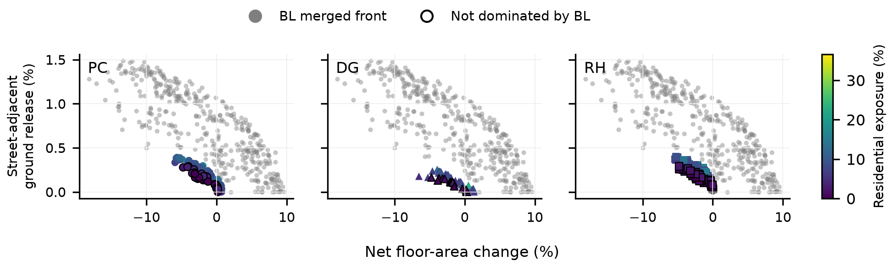
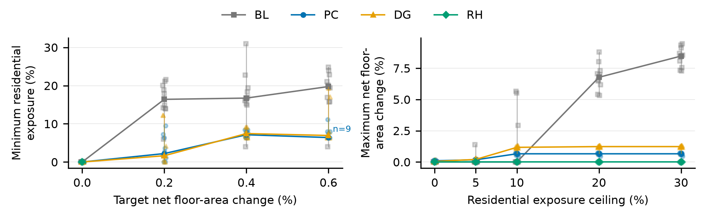
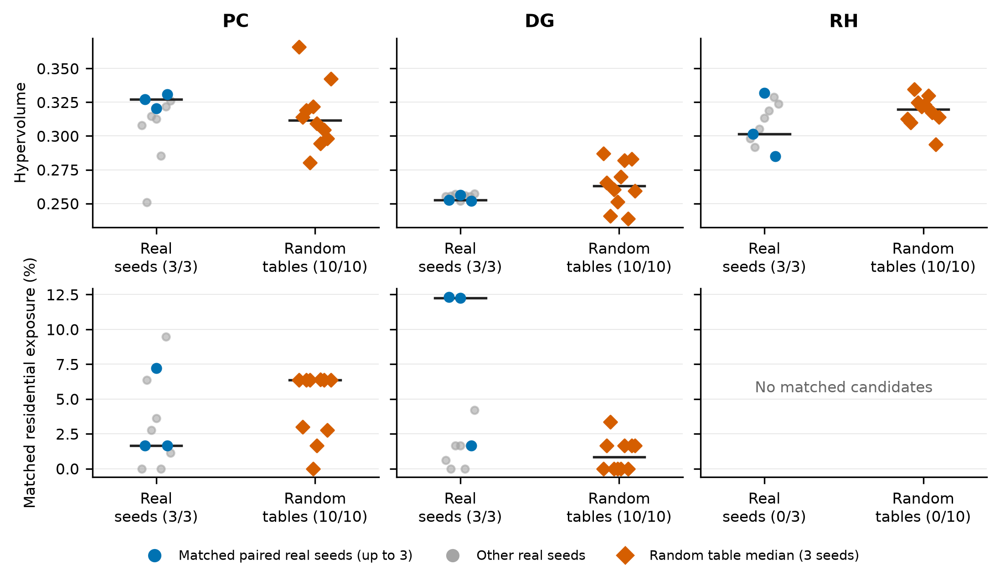
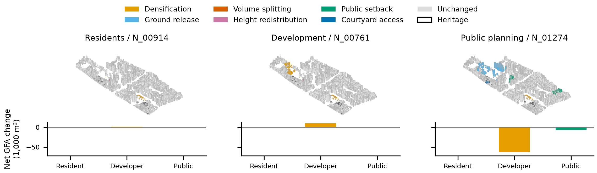

# 从利益相关者权力到城市形态：上海打浦桥城市更新的多目标生成与事后偏好框架

## 1. 摘要

历史街区更新需要协调居住、开发与遗产保护诉求。本文以上海打浦桥的 1,370 栋建筑为例，将主体类别与六种形态操作绑定，以权限表规定谁可以修改哪些建筑及其改动强度。在共同约束和三个目标下，NSGA-II 分别搜索参数基线、公共协调、开发增长和居民与遗产优先四组方案，再按居民、开发实施和公共规划三种视角选择代表方案。10 个配对种子的结果显示，权限配置改变了净建筑面积变化、居住暴露和临街释放的组合。在 0.2% 净增建档，参数基线、公共协调和开发增长的最低居住暴露中位数分别为 16.41%、2.21% 和 1.65%；暴露上限放宽至 20% 后，参数基线取得更大的增建容量。权限匹配零模型中，公共协调与开发增长呈现不同方向的变化。部分治理情景方案保留了参数基线未支配的目标取舍。我们还搭建了一个三维交互平台，供使用者比较不同情景的方案、切换角色视角，并查看指标差异对应的建筑改动，为方案选择和讨论提供直观依据。

**关键词：** 存量城市更新；遗产保护；多目标优化；利益相关者；参与式规划

## 2. 引言

历史街区更新需要同时处理建筑保护、居住改善和开发利用。增加开发容量可能涉及既有住宅的改动，释放地面空间也可能影响原有经营和日常生活。因此，方案评价既涉及空间利用效率，也涉及收益与代价在不同主体之间的分配。田子坊的实地研究将空间演变与政府、商户等行动者的权力关系联系起来，表明空间使用和改造权限是理解街区变化的重要线索（Wang & Zhou, 2022）。本文据此关注利益相关者权力在模型中的具体表达：哪些对象可以改动、允许怎样改动，以及不同主体如何选择方案。

计算设计为探索和比较更新方案提供了工具。SIMForms 将形态生成、指标评价和可视化结合起来（Zhang et al., 2024）。多目标优化（multi-objective optimization）同时考察多个相互制约的目标，并保留各有得失的方案。如果一个方案在所有目标上均不差于另一方案，且至少一项目标更好，便称其支配（dominance）另一方案。由未被其他候选方案支配的方案构成的帕累托解集（Pareto set），能够呈现增建、居住影响与地面空间释放之间的取舍（Deb et al., 2002）。对历史街区而言，生成过程还需要明确建筑改动权限和保护要求，使方案探索与当地的更新条件相联系。

参与式遗产规划通过共同设计和共同决策，让参与者介入方案修改与选择（Leong & Janssen, 2022）。Kaim 等（2020）在土地利用优化中采用事后偏好（a posteriori preferences），即先生成具有不同目标取舍的方案，再根据利益相关者的偏好进行选择。这些研究引出本文的核心问题：如何在同一流程中表达生成前的操作权限和生成后的选择偏好，并追踪两者对应的空间后果？操作权限决定方案的可生成范围，选择偏好则决定参与者在这一范围内关注哪些结果。

本文以上海打浦桥为例，将三种治理情景转化为建筑改动规则，在共同目标下分别搜索方案，再依据不同角色的目标优先顺序选择代表方案。研究同时设置直接调整建筑高度和占地的参数基线（parametric baseline），作为对照方法。两类方法使用相同的城市数据、评价目标和共同约束，比较其方案范围、住宅改动和地面释放结果。研究的贡献是将“谁能改、如何改、如何选”落实为可执行、可检查的计算过程，并通过逐栋变化记录与三维展示，将总体指标连接到具体空间（图 2）。

## 3. 研究对象与数据

### 3.1 打浦桥的保护与更新需求

本研究选取上海打浦桥既有街区，重点关注田子坊及周边地区。田子坊的石库门里弄和旧厂房构成了街区的历史风貌，也承载着居住、商业经营和文化活动。《黄浦区田子坊地区综合管理办法》要求在保护特色建筑、活化旧厂房的同时，改善社区设施、保障房屋安全并协调商居关系（黄浦区人民政府，2023）。这些要求共同构成街区更新的治理背景。

在这样的街区中，同一项增建或地面空间释放操作，作用于住宅、商业建筑和保护建筑时，会面临不同限制，并影响不同使用者。研究因此将建筑的保护状态和主体类别纳入模型，以比较不同操作权限如何改变建筑干预的位置、方式和规模。

### 3.2 现状模型与更新单元

研究整合建筑轮廓、高度、用途、街网及保护建筑资料，建立包含 1,370 栋建筑的现状模型。道路围合形成 38 个更新单元（renewal units），作为组织形态操作和检查空间控制条件的基本范围。程序在每栋建筑轮廓内部取一个代表点，通过点是否位于单元内部确定所属单元，再按建筑 ID 保存匹配结果。各单元的控制参数通过单元编号关联。未匹配到单元的 32 栋建筑在模拟中保持现状。面积和距离统一采用投影坐标计算。

保护建筑依据黄浦区官方记录与现状建筑轮廓进行匹配。已匹配的 21 个建筑轮廓在模型中保持不变；另有 4 条记录因历史范围或现状对应关系待核验，保留在审查资料中。实验固定使用同一版本的输入数据，以保证不同方法和情景之间的可比性。

图 1 从左至右展示上海定位、研究区卫星影像，以及用于模型权限分配的主体标签。右侧以轮廓标出遗产冻结和未匹配单元的建筑。

**图 1.** 研究区位置、范围与主体标签；黑色轮廓为遗产冻结建筑，紫色轮廓为未匹配单元建筑。

## 4. 方法

### 4.1 总体流程

框架将更新方案的形成分为生成与选择两个阶段（图 2）。生成阶段从现状模型出发，依据治理情景确定可改动建筑及其操作范围，生成候选方案；通过约束检查后，计算三个共同目标，并保留具有不同取舍的帕累托方案。选择阶段根据各角色的目标优先顺序排列方案，提取代表结果，再通过三维视图和逐栋记录检查其空间变化。

各情景独立搜索并共用评价目标；角色偏好在搜索结束后应用。

**图 2.** 方案生成与选择流程。三种情景分别设定建筑操作权限，共用约束和三个评价目标；每组帕累托方案再供角色排序。

### 4.2 治理情景与形态规则

模型依据建筑用途与属性映射居民、开发主体和公共资产三类主体标签（stakeholder labels），作为建筑操作权限的代理标签，并结合保护状态确定可执行操作。三个治理情景为公共协调（Public Coordination，PC）、开发增长（Development Growth，DG）和居民与遗产优先（Resident and Heritage，RH），通过可改动对象、操作类型、强度和范围形成差异（表 1）。

| 情景 | 操作重点 | 主要限制 |
|---|---|---|
| 公共协调 | 开发主体有限增建、释放地面和高度退让；公共资产沿街退界；居民院落通行改善 | 保护建筑及主体类别不明的建筑保持现状 |
| 开发增长 | 开发主体增建、释放地面和大体量拆分 | 居民住宅仅允许低强度通行改善；保护建筑及主体类别不明的建筑保持现状 |
| 居民与遗产优先 | 开发主体释放地面或转移高度；公共资产与居民住宅进行低强度改善 | 限制住宅的强形态干预；保护建筑及主体类别不明的建筑保持现状 |

**表 1.** 三种治理情景的操作重点与限制

操作权限通过形态算子（morphological operators）执行。每个算子是一条改变建筑高度、占地或体量的计算规则，包含适用对象、变化方式和操作强度。六种算子覆盖增建、占地收缩、体量拆分、高度调整以及通行空间改善（表 2）。例如，释放地面算子先收缩建筑占地，再在限高和容量允许的范围内增加高度，以补偿部分建筑面积；同一操作由此可能同时影响地面空间与周边住宅。

| 形态算子 | 建筑变化 | 主要控制条件 |
|---|---|---|
| 合规增建（densification） | 保持占地，增加建筑高度 | 最大增高比例为 30%，同时受限高和单元剩余容量约束 |
| 释放地面（ground release） | 收缩占地，并尝试通过增高补偿建筑面积 | 最大占地收缩比例为 25%，补偿高度受限高约束 |
| 大体量拆分（volume splitting） | 在建筑中部切出间隙，并尝试增加高度补偿面积 | 适用于占地至少 300 m² 的建筑，间隙随操作强度变化 |
| 敏感对象退让（height redistribution） | 在同一单元内降低住宅及遗产附近建筑的高度，并向较远处转移 | 调整后仍需满足限高及单元容量约束 |
| 公共资产浅退界（public-asset setback） | 收缩公共资产建筑的临街占地，保持高度 | 沿街最多退让 4 m |
| 居民院落通行改善（courtyard access improvement） | 从临街侧向院落切出候选通道，保持高度 | 通道最宽 3 m |

**表 2.** 六种形态算子的变化方式与控制条件；实际变化由操作强度、原始轮廓和约束余量共同确定。

生成后的方案须满足硬约束（hard constraints），即决定方案能否进入后续比较的必要条件。检查涵盖几何有效性、研究边界、保护对象不变、限高、单元容积率、建筑覆盖率、住宅保留、新增重叠和最大改动范围。其中，容积率（floor area ratio，FAR）为单元内总建筑面积与单元面积之比，建筑覆盖率（building coverage ratio）为建筑占地与单元面积之比。前八项检查由各方法共用，最大改动范围及操作权限随情景设定。程序先依据约束余量调整操作强度，再统一检查候选方案，淘汰仍违反条件的结果。每次操作均保存建筑编号、所属单元、操作类型、强度及前后属性，供后续追踪。

### 4.3 三个共同评价目标

三个目标分别描述住宅受影响范围、净建筑面积变化和临街地面释放潜力。为便于跨方案比较，各指标均按相应的基准面积归一化。总建筑面积（gross floor area，GFA）用于计算住宅规模及建筑面积变化。

**居住影响暴露（residential impact exposure）**衡量可能受到形态变化影响的住宅建筑面积比例，取值越低越好。模型将高度变化达到 0.1 m 或足迹变化达到 1 m² 的住宅计为直接受影响；建筑实际增高达到 0.1 m，或其面积不少于 1 m² 的连通体量数量增加时，将同单元的住宅计为间接受影响。释放地面的补偿增高也按此规则计算。同一住宅只计一次，分母保持为现状住宅建筑面积：

\[
f_1 = \frac{\sum_{i \in R,\,i\ exposed} GFA_i^{base}}{\sum_{i \in R} GFA_i^{base}}
\]

其中，\(R\) 为住宅建筑集合，\(GFA_i^{base}\) 为建筑 \(i\) 的现状总建筑面积，\(exposed\) 表示满足上述条件。以更新单元识别间接影响，可以将干预周边住宅纳入评价；因此，直接改动的住宅较少时，暴露值仍可能较高。

**净建筑面积变化（net floor-area change）**为方案与现状总建筑面积之差除以研究区面积，取值越高表示净增建越多：

\[
f_2 = \frac{\sum_i (GFA_i^{proposal}-GFA_i^{base})}{A_{site}}
\]

其中，\(GFA_i^{proposal}\) 和 \(GFA_i^{base}\) 分别为方案与现状建筑面积，\(A_{site}\) 为研究区面积。增建与拆减在净值中相互抵消，结果同时报告两者的总量。

**临街地面释放潜力（street-adjacent ground-release potential）**衡量建筑占地收缩后，在道路附近形成的地面空间，取值越高越好：

\[
f_3 = \frac{Area[(Footprint_{base}-Footprint_{proposal}) \cap StreetBuffer_{5m}]}{Area(StreetBuffer_{5m} \cap Site)}
\]

其中，\(Footprint\) 为建筑占地范围，\(StreetBuffer_{5m}\) 为道路两侧的 5 m 缓冲范围。指标提取现状占地与方案占地之差，再计算其中落入道路缓冲区的面积，因而侧重反映与街道相邻的空间释放机会。

### 4.4 多目标搜索与角色选择

研究采用非支配排序遗传算法 II（Non-dominated Sorting Genetic Algorithm II，NSGA-II）搜索方案（Deb et al., 2002）。算法从一组候选方案出发，通过反复生成、评价和筛选，逐步保留具有不同目标取舍的结果。每个候选都经过情景操作、约束检查和三目标计算；现状方案作为共同参照。搜索结束后，采用容差阈值（epsilon tolerance）合并指标差异很小的方案，使解集更便于比较。

角色选择采用按优先顺序逐项比较的排序方式。当一项目标的差异处于容差范围内时，继续比较下一项目标。三种角色的比较顺序如下：

| 角色 | 第 1 优先级 | 第 2 优先级 | 第 3 优先级 |
|---|---|---|---|
| 居民 | 居住影响暴露（越低越好） | 净建筑面积变化（越高越好） | 临街地面释放（越高越好） |
| 开发实施 | 净建筑面积变化（越高越好） | 临街地面释放（越高越好） | 居住影响暴露（越低越好） |
| 公共规划 | 临街地面释放（越高越好） | 居住影响暴露（越低越好） | 净建筑面积变化（越高越好） |

**表 3.** 三种角色的逐级目标排序。目标差异小于对应的 ε 容差时，进入下一优先级比较。优先顺序借鉴事后偏好研究（Kaim et al., 2020）。

框架还提供兼顾各角色的折中方案：先记录每个方案在不同角色排序中的名次，再选出其中最差名次最靠前的方案。这一选择方式优先改善方案在最不利角色排序中的位置，为多方比较提供共同起点。

### 4.5 实验设计

实验比较参数基线（Parametric Baseline，BL）与三个治理情景：公共协调（PC）、开发增长（DG）和居民与遗产优先（RH）。BL 通过高度倍率 1.00–1.30 和占地保留比例 0.75–1.00 调整建筑；治理情景采用对象权限和形态操作。四组共用输入数据、三个目标和共同约束：限高 36 m、单元容积率 3.0、覆盖率 0.60、住宅总建筑面积最低保留 0.80。高度、容积率和覆盖率采用设定值与现状值中较大者作为上限。

每组采用 40 个个体的种群、50 个计划代数，以 10 个相同的随机种子配对运行；每次运行固定 2,000 次原始评价，保存输入、参数、逐栋变化和结果记录。超体积采用四组共同归一化和共同参考点（Zitzler & Thiele, 1999），结果报告中位数、种子范围及匹配数量。

实验按表 4 组织。本轮报告 E0 主实验、E1 权限匹配零模型及 E6 公平比较；E2、E3 提供标签与约束记录，E4、E5 为后续检验。

**表 4.** 实验目的、比较方式与研究问题。E0–E6 为本文的实验编号。

| 实验 | 意图 | 比较或计算 | 能回答的问题 |
| --- | --- | --- | --- |
| E0 主实验 | 比较四组方案空间 | 同输入、目标、约束、预算及 10 个配对种子；比较 Pareto 前沿与超体积 | 各组找到哪些容量、暴露和临街释放组合 |
| E1 权限检验 | 分清权限数量与主体归属的作用 | 保留逐单元可改栋数与近似面积，随机分配各算子的建筑权限 | 在操作机会近似相同时，权限落在哪些建筑上是否改变前沿 |
| E2 标签统计 | 说明主体类别及操作对象 | 用途与属性到标签的规则、各类别栋数和面积、分单元 unknown 比例；另做标签扰动 | 标签如何分配，实际修改集中在哪些主体 |
| E3 约束统计 | 确认哪些控制实际生效 | 按方法和种子统计降强度、淘汰次数及占比 | 高度、FAR、范围等在哪一步限制方案 |
| E4 暴露尺度 | 检查单元划分对暴露评价的影响 | 同一批方案改用 25、50、100 m 距离重算暴露并排序 | 暴露值和方案排序是否随距离改变 |
| E5 选择容差 | 检查相近方案合并与选择的稳定性 | ε 乘以 0.5 和 2，重新筛选和排序 | 首选是否依赖容差 |
| E6 公平比较 | 比较同等收益或同等代价 | 净增建窄带匹配、暴露上限筛选；对照 BL 合并前沿 | 同等条件下的暴露、容量、释放及未被 BL 支配的 Pareto 解比例 |

权限匹配零模型对 PC、DG、RH 各生成 10 张随机权限表，每表使用 11、23、37 三个配对种子，共 90 次搜索，预算与主实验相同。随机化保持各单元、各算子的可改栋数不变，可改现状建筑面积误差不超过 5%；住宅标签、保护状态、强度和改动范围保持不变。零模型的超体积按全部 130 次运行共同归一化；配对差异先在每表三个种子间取中位数，再在十张表间取中位数。

净增建匹配容差为 ±0.05 个百分点。每个种子分别计算匹配候选的最小暴露，再跨种子取中位数；暴露上限筛选则先计算各种子内的最大净增建，再取中位数。无匹配的档位保持缺失，并报告有匹配候选的种子数。BL 支配分析将 10 个 BL 种子的 Pareto 解合并后再筛选，以此判断各治理情景的 Pareto 解是否被支配。

### 4.6 交互平台

平台使用与正文相同的统一暴露指标和正式搜索结果。统计面板汇总十个种子，三维探索固定展示 seed 97 的前沿，便于与角色比较图对应。平台将情景选择、角色选择和方案探索组织为连续的操作步骤。用户选择情景后，可在目标散点图中查看方案取舍，选择角色后查看对应排序，再点击方案联动显示三维形态和方案指标；逐栋记录在导出结果中呈现操作前后的高度、占地与建筑面积，使总体指标能够追溯到具体改动。

设置面板允许调整情景参数并重新计算。每次运行独立保存参数与结果，完成后刷新方案及三维视图。用户由此可以检查某项权限或强度变化如何影响可选方案，并据此继续修订更新设定。

**图 3.** 交互平台中的情景选择、角色切换、方案散点图和三维形态。

## 5. 结果

### 5.1 方案比较

四组共完成 40 次搜索，每次 2,000 次原始评价。表 5 汇总十个种子的结果。

**表 5.** 主实验结果。有效评价、Pareto 数量与最大净增建列为种子范围；可行率、超体积和最大临街释放列为种子中位数。

| 方法 | 有效评价 | 可行率 | Pareto 数量 | 超体积 | 最大净增建 | 最大临街释放 |
|---|---:|---:|---:|---:|---:|---:|
| BL | 1929–1962 | 0.892 | 96–147 | 0.849 | 7.283–9.540% | 1.423% |
| PC | 1433–1575 | 0.964 | 10–27 | 0.281 | 0.407–0.716% | 0.327% |
| DG | 1516–1575 | 0.976 | 9–15 | 0.225 | 0.708–1.340% | 0.233% |
| RH | 1267–1432 | 0.937 | 10–21 | 0.289 | -0.004–0.000% | 0.350% |

**表 6.** 相同净增建档内的最低居住暴露，跨种子中位数；括号为匹配种子数。

| 净增建档 | BL | PC | DG | RH |
| --- | ---: | ---: | ---: | ---: |
| 0.0% | 0.00%（10/10） | 0.00%（10/10） | 0.00%（10/10） | 0.00%（10/10） |
| 0.2% | 16.41%（10/10） | 2.21%（10/10） | 1.65%（10/10） | 无匹配（0/10） |
| 0.4% | 16.73%（10/10） | 7.14%（10/10） | 7.45%（10/10） | 无匹配（0/10） |
| 0.6% | 19.76%（10/10） | 6.40%（9/10） | 6.94%（10/10） | 无匹配（0/10） |

**表 7.** 居住暴露上限下的最大净增建，跨十个种子中位数。

| 住宅暴露上限 | BL | PC | DG | RH |
| --- | ---: | ---: | ---: | ---: |
| 0% | 0.000% | 0.100% | 0.044% | 0.000% |
| 5% | 0.000% | 0.178% | 0.206% | 0.000% |
| 10% | 0.000% | 0.657% | 1.172% | 0.000% |
| 20% | 6.776% | 0.657% | 1.232% | 0.000% |
| 30% | 8.472% | 0.657% | 1.232% | 0.000% |

BL 的十个种子合并后得到 398 个非支配点。PC、DG、RH 前沿中未被该合并前沿支配的逐种子比例见表 8。

**表 8.** 未被 BL 合并前沿支配的方案比例。

| 情景 | 中位数 | 种子范围 |
| --- | ---: | ---: |
| PC | 42.37% | 27.78%–46.67% |
| DG | 33.33% | 15.38%–55.56% |
| RH | 57.14% | 36.36%–90.00% |

**图 4.** 三种治理情景的合并前沿与 BL 对照。灰点为 BL；彩色点按居住暴露着色，黑色描边表示未被 BL 支配。三面板采用相同坐标和色阶。

**图 5.** 相同净增建与暴露上限下的四组比较。浅色点为各种子结果，实线为中位数，竖线为种子范围；缺失位置断开，n 标明不足十个匹配种子的档位。

**表 9.** 权限匹配零模型相对真实权限的配对差值，中位数；暴露按 0.2% 净增建档匹配。

| 情景 | HV 差值 | 0.2% 增建档暴露差值 |
| --- | ---: | ---: |
| PC | -0.01378 | +0.96 个百分点 |
| DG | +0.01030 | -10.59 个百分点 |
| RH | +0.00016 | 无匹配 |

**图 6.** 权限匹配零模型的超体积与匹配暴露。蓝点为三个配对种子的真实情景，灰点为其余真实情景种子，橙点为每张随机权限表的三种子中位数。横轴标出匹配数量；RH 的正增建匹配保持缺失。

**图 7.** PC seed 97 的三个角色首选方案。三幅图采用相同正投影视角和范围，改动建筑按算子着色，下方显示按主体类别汇总的净建筑面积变化。

**表 10.** PC seed 97 的角色首选。

| 角色 | 方案编号 | 居住暴露（%） | 净建筑面积变化（m²） | 增建（m²） | 拆减（m²） | 临街释放（%） |
|---|---|---:|---:|---:|---:|---:|
| 居民 | N_00914 | 0.00 | 1,585 | 1,698 | 114 | 0.000 |
| 开发实施 | N_00761 | 6.36 | 9,892 | 10,005 | 114 | 0.000 |
| 公共规划 | N_01274 | 6.96 | -70,089 | 1,554 | 71,644 | 0.322 |

### 5.2 平台专业评估

邀请三位具有建筑或规划背景的参与者进行平台操作与主观评分。任务包括比较 PC 与 DG、在指定净增建附近各选一个方案、切换居民与开发视角，并说明最终选择。

任务后回答五道 1–5 分题（1 为非常不同意，5 为非常同意）：

1. 我能看懂不同情景允许修改哪些建筑。
2. 我能看懂容量、居住暴露与临街释放之间的取舍。
3. 我能理解切换角色后方案选择为什么改变。
4. 我能通过图表和三维视图比较两个方案。
5. 平台帮助我选择方案并说明理由。

**表 11.** 三位参与者的平台主观评分。

| 参与者 | 问题 1 | 问题 2 | 问题 3 | 问题 4 | 问题 5 |
|---|---:|---:|---:|---:|---:|
| 1 | 5 | 5 | 4 | 4 | 5 |
| 2 | 4 | 3 | 5 | 5 | 4 |
| 3 | 5 | 3 | 5 | 4 | 4 |
| 均值 | 4.67 | 3.67 | 4.67 | 4.33 | 4.33 |

总体平均评分为 4.33 分。权限理解与角色选择理解的平均评分均为 4.67 分，目标权衡理解为 3.67 分。

## 6. 讨论

相同净增建下的暴露比较揭示了权限安排的空间后果。0.2% 档中，BL 的最低暴露中位数为 16.41%，PC 和 DG 分别为 2.21% 和 1.65%。同一增建目标可以通过不同建筑与单元组合实现，权限规则使搜索集中到不同位置。临街释放、住宅暴露与增建容量由此形成不同组合。

暴露上限提高后，BL 的增建容量明显增加，而 PC、DG 的容量较早趋于平稳。较低暴露约束下，治理情景能够提供增建机会；允许更多住宅进入受影响范围后，参数基线更宽的调整范围释放出更大容量。这一差异将更新选择转化为具体问题：新增面积需要多少住宅承担影响，以及释放地面是否值得接受净面积减少。

BL 合并前沿仍未覆盖部分治理情景的取舍。PC、DG、RH 未被支配比例的中位数分别为 42.37%、33.33% 和 57.14%。这些方案在三个目标的组合上保留了区别，较低暴露与临街释放共同构成其保留价值。RH 在所测正增建档没有匹配候选，反映其操作重点更接近以面积调整换取地面改善。

权限匹配零模型进一步比较操作机会落在哪些建筑上的影响。保持逐单元可改栋数和近似面积后，PC 的真实权限对应更高超体积，DG 的随机权限对应更高超体积，RH 差异较小。主体归属的作用随情景而变。DG 在三个配对种子的 0.2% 档暴露分别为 12.32%、12.24% 和 1.65%，而十个种子的中位数为 1.65%；这组差异也说明，单一低暴露首选不能概括整个搜索分布。平台并列呈现候选点与角色首选，使这种差异可以被检查。

同一 PC 前沿中的三个角色选择了不同的建筑组合。居民视角优先压低住宅暴露，开发实施视角保留增建，公共规划视角通过更大幅度的占地和面积调整释放地面。将三维形态与逐栋面积变化连接起来，有助于把抽象的目标取舍落实到可讨论的空间改动。三位参与者对权限与角色选择理解的评分较高，而对目标权衡理解的评分较低，提示界面需要进一步解释容量、暴露与地面释放之间的关系。

## 7. 结论

本文将主体类别、建筑操作权限和事后角色偏好连接为可执行的城市更新流程。统一指标下的四组主实验表明，PC、DG 在较低暴露条件下提供了不同于 BL 的增建组合；暴露上限放宽后，BL 获得更大容量。权限匹配零模型显示，权限落在何处会改变前沿，但其作用方向随情景而变。平台以同一批结果连接目标比较、角色选择和建筑形态，为专业参与者讨论更新收益与居住代价提供依据。

## 参考文献

Deb, K., Pratap, A., Agarwal, S., & Meyarivan, T. (2002). A fast and elitist multiobjective genetic algorithm: NSGA-II. IEEE Transactions on Evolutionary Computation, 6(2), 182–197. https://doi.org/10.1109/4235.996017

Kaim, A., Strauch, M., & Volk, M. (2020). Using stakeholder preferences to identify optimal land use configurations. Frontiers in Water, 2, 579087. https://doi.org/10.3389/frwa.2020.579087

Leong, S. L., & Janssen, P. (2022). Participatory planning: Heritage conservation through co-design and co-decision. In Proceedings of CAADRIA 2022 (Vol. 2, pp. 505–514).

Wang, M., & Zhou, Y. (2022). The production and evolution of urban cultural and creative tourism destination from the perspective of power space: A case study of Tianzifang, Shanghai. Geographical Research, 41(2), 373–389. https://doi.org/10.11821/dlyj020201265

Zhang, B., Mo, Y., Li, B., Wang, Y., Zhang, C., & Shi, J. (2024). SIMForms: A web-based generative application fusing forms, metrics, and visuals for early-stage design. In Proceedings of CAADRIA 2024 (Vol. 1, pp. 373–382). https://doi.org/10.52842/conf.caadria.2024.1.373

Zitzler, E., & Thiele, L. (1999). Multiobjective evolutionary algorithms: A comparative case study and the strength Pareto approach. IEEE Transactions on Evolutionary Computation, 3(4), 257–271. https://doi.org/10.1109/4235.797969

OpenStreetMap contributors. *OpenStreetMap data*. <https://www.openstreetmap.org/copyright>

OpenFreeMap. *Positron map style*（© OpenMapTiles，数据来自 OpenStreetMap）. <https://openfreemap.org/>

Esri. *World Imagery*（含影像供应方与 GIS User Community 贡献）. <https://www.arcgis.com/home/item.html?id=10df2279f9684e4a9f6a7f08febac2a9>

EOX IT Services GmbH. *Sentinel-2 cloudless 2016 imagery*（含改编的 Copernicus Sentinel 数据，CC BY 4.0）. <https://cloudless.eox.at/license-non-commercial>

黄浦区人民政府（2023）。《黄浦区田子坊地区综合管理办法》，黄府规〔2023〕3 号，2023 年 3 月 12 日施行。<https://service.shanghai.gov.cn/XingZhengWenDangKuJyh/XZGFDetails.aspx?docid=230220141250SGUTAJDzyGiwTLVshtA>
