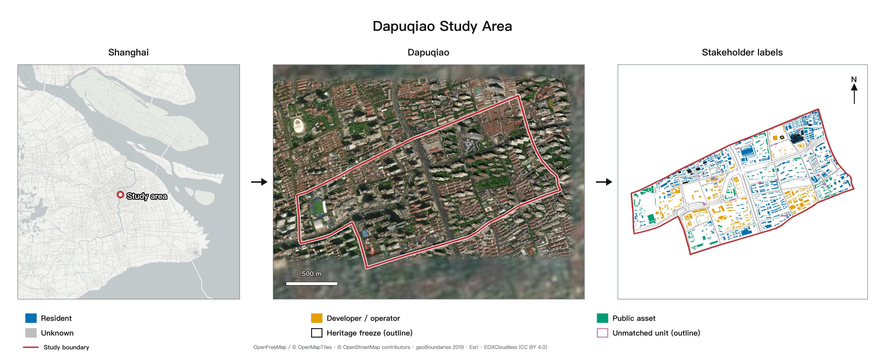
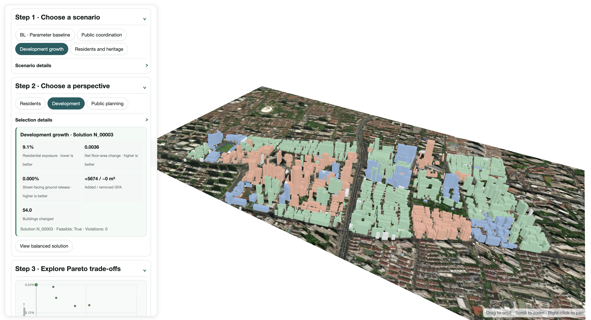
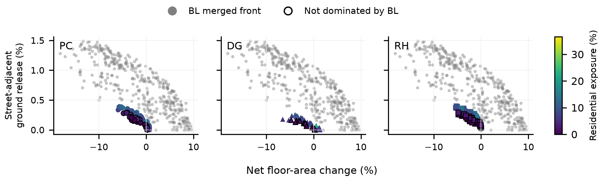
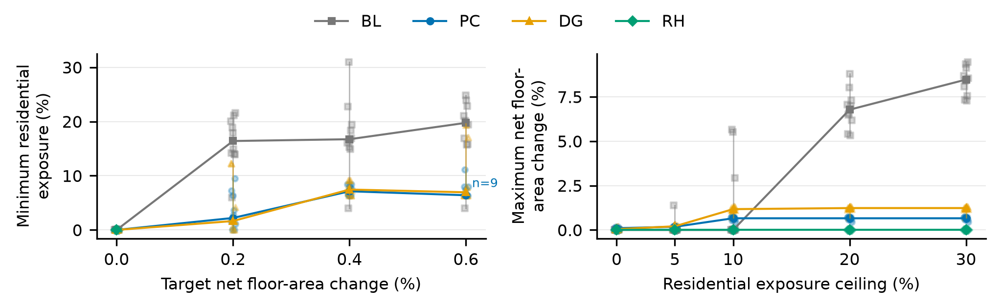
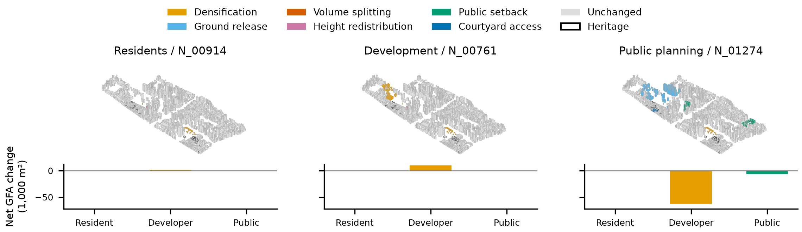

# 利益相关者驱动的城市形态模拟：面向历史街区参与式更新的交互计算工具

## 摘要

历史街区更新需要协调居住需求、开发利益与遗产保护。本研究以上海打浦桥的1,370栋建筑为对象，将利益相关者类别转化为建筑改动权限。通过NSGA-II算法，在共同约束下搜索参数基线和三种治理情景，比较居住暴露、净增建筑面积和临街地面释放，再依据不同角色的目标优先级选择代表方案。十个配对随机种子的结果表明，在净增建筑面积比为0.2%的匹配档内，最低居住暴露的中位数分别为参数基线16.41%、公共协调2.21%和开发增长1.65%。提高暴露上限后，参数基线获得更大的开发容量；部分治理方案仍未被其合并前沿支配。随机分配权限对不同情景的影响方向不同。我们还搭建了一个交互式三维平台，将指标权衡与逐栋建筑变化联系起来。三位具有建筑或规划背景的参与者认为，平台对权限规则和角色选解的解释优于对目标权衡的解释。

**关键词：** 城市更新，遗产保护，多目标优化，利益相关者，参与式规划

## 1. 引言

历史街区更新涉及住房改善、开发和保护，也涉及居民、经营者与公共部门之间收益和代价的分配。田子坊研究将空间变化与权力关系、空间使用及改造权联系起来（Wang & Zhou, 2022）。因此，计算模型既要评价更新形态，也要表达谁可以改动哪些建筑。

SIMForms等生成式工具连接了形态生成、评价与可视化（Zhang et al., 2024）。参与式遗产规划通过共同设计和共同决策形成、选择方案（Leong & Janssen, 2022）；土地利用优化也可以在生成方案后引入利益相关者偏好（Kaim et al., 2020）。本研究将生成前的改动权限与生成后的角色偏好连接起来，回答两个问题：建筑权限如何改变可实现的目标权衡？不同角色如何从同一组备选方案中选择不同形态？

研究在相同数据、共同约束和评价目标下，比较三种治理情景与参数基线。在相近增建量下比较居住暴露，在相同暴露上限下比较开发容量；通过权限匹配零模型检验改动机会的分配，并用三维平台展示具体建筑变化，支持方案检查和讨论。

## 2. 研究区域与数据

研究范围为上海打浦桥田子坊及周边街区，包含石库门住宅、原工业建筑和商业空间。黄浦区相关管理办法提出特色建筑保护、旧厂房再利用、社区设施与安全改善，以及商住关系协调等要求（Huangpu District People's Government, 2023）。

模型整合了1,370栋建筑的轮廓、高度、用途、街道及保护记录。建筑和街道数据来自OpenStreetMap contributors（n.d.）。街道划分出38个更新单元。程序判断建筑轮廓内部代表点是否落入单元边界，再通过建筑ID和单元ID关联几何与控制参数。32栋未匹配单元的建筑，以及与官方保护记录对应的21栋建筑保持不变。面积和距离均在投影坐标系中计算，所有实验采用相同输入。

**图1.** 研究区域、影像与利益相关者标签。黑色轮廓表示保护建筑，紫色轮廓表示未匹配单元的建筑。来源：OpenFreeMap（n.d.）、Esri（n.d.）和EOX IT Services GmbH（n.d.）。

## 3. 研究方法

### 3.1 改动权限与形态生成

根据建筑用途和属性，将建筑标记为居民、开发主体和公共资产三类，作为分配操作权限的代理标签。公共协调（Public Coordination，PC）、开发增长（Development Growth，DG）和居民与遗产优先（Residents and Heritage Priority，RH）在可改对象、操作类型、强度和范围上存在差异（表1）。各情景独立生成备选方案，角色偏好在搜索完成后用于选解。

**表1.** 三种治理情景。保护建筑和主体标签未知的建筑在三种情景中均保持不变。

| 情景 | 改动重点 | 主要限制 |
|---|---|---|
| PC | 对开发主体建筑进行有限增建、地面释放与高度重分配；公共资产退界；改善住宅通行 | 保护建筑和标签未知建筑保持不变 |
| DG | 对开发主体建筑进行增建、地面释放和体量拆分 | 住宅仅允许低强度通行改善 |
| RH | 对开发主体建筑进行地面释放或高度重分配；对公共资产和住宅进行低强度改善 | 限制高强度住宅改动 |

六类形态操作规定几何变化方式和强度上限（表2）。例如，地面释放缩减建筑轮廓，并在剩余容量允许时通过增高补偿建筑面积。

**表2.** 形态操作及控制条件。

| 操作 | 建筑变化 | 主要控制 |
|---|---|---|
| 增建 | 保持轮廓，提高建筑高度 | 增高幅度不超过30%，同时满足限高和单元剩余容量 |
| 地面释放 | 缩减轮廓，尝试通过增高补偿建筑面积 | 轮廓最多缩减25%，高度补偿受限高约束 |
| 体量拆分 | 在建筑中部形成间隙，尝试增高补偿 | 适用于占地面积至少300 m²的建筑，间隙随操作强度变化 |
| 高度重分配 | 降低住宅和遗产建筑附近的高度，并向同单元较远建筑转移 | 调整后须满足限高与单元容量要求 |
| 公共资产退界 | 缩减公共资产临街轮廓，保持高度 | 最大退界4 m |
| 院落通行改善 | 从临街边缘向院落切出候选通道，保持高度 | 最大通道宽度3 m |

候选方案须通过几何有效性、研究边界、建筑保护、高度、单元容积率（FAR）、建筑覆盖率、住宅保留和重叠检查。容积率为建筑总面积与单元面积之比，覆盖率为建筑占地与单元面积之比。权限与最大改动范围按情景设置。程序先依据剩余容量降低操作强度，再淘汰仍不满足约束的方案，并记录每栋改动建筑的ID、单元、操作、强度及改动前后属性。

### 3.2 评价目标

三个目标分别为最小化居住暴露、最大化净增建筑面积比和最大化临街地面释放率。建筑总面积以GFA表示。

**居住暴露**为直接或间接受影响的既有住宅建筑面积占比。住宅高度变化至少0.1 m，或轮廓变化至少1 m²时，计为直接暴露。单元内任一建筑增高至少0.1 m，或面积至少1 m²的连通体量数量增加时，该单元住宅计为间接暴露。地面释放中的补偿增高采用相同规则。每栋住宅仅计一次：

\[
f_1 = \frac{\sum_{i \in R_{exposed}} GFA_i^{base}}{\sum_{i \in R} GFA_i^{base}}
\]

其中，\(R\)为全部住宅建筑，\(R_{exposed}\)为符合上述条件的住宅。按单元统计间接暴露，将改动建筑周边的住宅纳入计算。

**净增建筑面积比**为方案建筑面积与既有建筑面积之差，除以研究区域面积\(A_{site}\)：

\[
f_2 = \frac{\sum_i (GFA_i^{proposal}-GFA_i^{base})}{A_{site}}
\]

同时报告新增和移除建筑面积，以区分净值相近但改动规模不同的方案。

**临街地面释放率**为5 m街道缓冲区内释放的建筑占地面积，除以研究区域内的街道缓冲区面积：

\[
f_3 = \frac{Area[(Footprint_{base}-Footprint_{proposal}) \cap StreetBuffer_{5m}]}{Area(StreetBuffer_{5m} \cap Site)}
\]

### 3.3 搜索与角色选解

NSGA-II反复生成和评价候选方案，保留不同目标权衡（Deb et al., 2002）。若一个方案在全部目标上不差于另一方案，并至少有一个目标更好，则称其支配另一方案；未被其他候选支配的方案组成帕累托集合。搜索结束后，通过epsilon容差归并目标差异较小的方案。

角色按目标优先顺序对该集合排序。居民依次优先考虑较低暴露、较多净增建筑面积和较多地面释放；开发角色依次考虑较多净增建筑面积、较多地面释放和较低暴露；公共规划依次考虑较多地面释放、较低暴露和较多净增建筑面积。当前目标的差异小于对应epsilon容差时，继续比较下一目标。折中方案则选择三个角色中最差名次最好的方案。

### 3.4 实验设计

参数基线（Parametric Baseline，BL）采用1.00–1.30的高度倍率和0.75–1.00的轮廓保留比例。PC、DG和RH采用前述权限与形态操作。共同模型约束为限高36 m、单元容积率3.0、覆盖率0.60和住宅建筑面积保留比例0.80。限高、容积率和覆盖率取设定值与现状值中的较大值。

每种方法使用40个体、计划50代和十个配对随机种子，每次固定2,000次原始评价。有效评价统计实际发生变化且形态不同的方案；可行率为满足全部约束的记录方案占比，候选总数包含现状模型。超体积衡量前沿所支配的目标空间，采用共同归一化边界和参考点（Zitzler & Thiele, 1999）。结果报告跨种子的中位数和范围。表3汇总各项分析：本稿报告E0、E1和E6的比较，E2–E3记录标签与约束，E4–E5为后续分析。

**表3.** 实验比较与研究问题。E4–E5为后续分析。

| 实验 | 比较或计算 | 研究问题 |
|---|---|---|
| E0 主实验 | 四种方法共享数据、目标、共同约束、预算与十个配对种子 | 各方法能够形成哪些容量、暴露与地面释放组合？ |
| E1 权限检验 | 在单元内随机分配权限，保留可改建筑数量并近似匹配可改建筑面积 | 权限的位置分配是否改变帕累托前沿？ |
| E2 标签统计 | 标签规则、数量、面积、未知标签和标签扰动 | 哪些建筑被赋予标签，又实际受到改动？ |
| E3 约束统计 | 按方法、种子和约束统计强度降低及淘汰 | 哪些控制条件限制了候选生成？ |
| E4 暴露尺度 | 对相同方案按25、50、100 m距离重新计算 | 空间尺度如何改变暴露和排序？ |
| E5 选解容差 | 将epsilon乘以0.5和2，重新筛选与排序 | 容差如何改变首选方案？ |
| E6 匹配比较 | 匹配净增建档、暴露上限，并与BL合并前沿比较 | 在匹配条件下，收益与代价有何差异？ |

权限匹配零模型为每种治理情景生成十张随机权限表，分别使用配对种子11、23和37，共90次搜索，预算与主实验一致。随机化保留各单元内每类操作的可改建筑数量，并将可改建筑的既有总面积匹配在5%误差内。住宅标签、保护状态、强度和改动范围保持不变。零模型超体积采用全部130次搜索的共同边界。配对差值按“随机权限减原始权限”计算，先取每张权限表三个种子的中位数，再取十张表的中位数。

净增建筑面积比采用±0.05个百分点的匹配容差。对每个种子，分别记录各档内最低暴露和各暴露上限下的最大净增建筑面积比，再汇总中位数与匹配种子数。未匹配条件保留缺失。支配分析将十个BL前沿合并并筛选为一个参考前沿。

### 3.5 交互平台

平台连接情景选择、目标散点图、角色排序和建筑三维视图（图2）。统计汇总十个种子，三维浏览采用与角色比较相同的种子97。用户选择情景、查看权衡、切换角色，再打开具体方案的形态与逐栋改动记录。平台还支持调整情景参数后重新计算，并保存每次运行的设置与结果。

**图2.** 平台界面将情景、角色、目标权衡和建筑形态联系起来。

## 4. 结果

### 4.1 方案比较

四种方法共完成40次搜索，每次2,000次原始评价（表4）。

**表4.** 十个种子的主实验结果。有效评价、帕累托解数和最大净增建筑面积比报告范围，其余列报告中位数。

| 方法 | 有效评价 | 可行率 | 帕累托解数 | 超体积 | 最大净增建筑面积比（%） | 最大临街地面释放率（%） |
|---|---:|---:|---:|---:|---:|---:|
| BL | 1929–1962 | 0.892 | 96–147 | 0.849 | 7.283–9.540 | 1.423 |
| PC | 1433–1575 | 0.964 | 10–27 | 0.281 | 0.407–0.716 | 0.327 |
| DG | 1516–1575 | 0.976 | 9–15 | 0.225 | 0.708–1.340 | 0.233 |
| RH | 1267–1432 | 0.937 | 10–21 | 0.289 | −0.004至0.000 | 0.350 |

BL合并参考前沿包含398个非支配点。各治理前沿中未被BL支配的方案比例，中位数分别为PC 42.37%（范围27.78–46.67%）、DG 33.33%（15.38–55.56%）和RH 57.14%（36.36–90.00%）（图3）。

**图3.** 治理前沿与BL（灰色）比较。颜色表示居住暴露，黑色轮廓标记未被BL支配的方案。各子图采用相同坐标轴和色标。

在净增建筑面积比0.2%档内，最低居住暴露的中位数为BL 16.41%、PC 2.21%、DG 1.65%，三者均有十个种子匹配，RH无匹配。在20%暴露上限下，最大净增建筑面积比的中位数依次为6.776%、0.657%、1.232%和0.000%（图4）。

**图4.** 净增建档与暴露上限的匹配比较。浅色点表示各种子，实线表示中位数，竖线表示范围。断开处表示无匹配，n标记少于十个匹配种子的条件。

权限匹配零模型的超体积配对差值中位数为PC −0.01378、DG +0.01030、RH +0.00016。在0.2%净增建档内，暴露配对差值为PC +0.96个百分点、DG −10.59个百分点，RH无匹配。原始DG权限在三个配对种子下的暴露分别为12.32%、12.24%和1.65%。

在PC种子97中，居民和开发角色分别选择净增1,585 m²与9,892 m²的方案，暴露分别为0.00%与6.36%。公共规划角色选择净减70,089 m²、临街地面释放率0.322%的方案（图5、表5）。

**图5.** PC种子97的三个角色首选方案，采用相同投影与范围。改动建筑按操作着色，下方图表显示各主体类别的净建筑面积变化。

**表5.** PC种子97的角色首选方案。

| 角色 | 方案ID | 居住暴露（%） | 净建筑面积变化（m²） | 新增面积（m²） | 移除面积（m²） | 临街地面释放率（%） |
|---|---|---:|---:|---:|---:|---:|
| 居民 | N_00914 | 0.00 | 1,585 | 1,698 | 114 | 0.000 |
| 开发 | N_00761 | 6.36 | 9,892 | 10,005 | 114 | 0.000 |
| 公共规划 | N_01274 | 6.96 | −70,089 | 1,554 | 71,644 | 0.322 |

### 4.2 平台评估

三位具有建筑或规划背景的参与者，在指定净增建筑面积附近比较PC和DG方案，切换居民与开发视角，并选择方案。完成后，对以下五项陈述按1分（非常不同意）至5分（非常同意）评分：

Q1. 我能理解各情景允许改动哪些建筑。

Q2. 我能理解开发容量、居住暴露与临街地面释放之间的权衡。

Q3. 我能理解为什么切换角色会改变首选方案。

Q4. 我能结合图表和三维视图比较两个方案。

Q5. 平台能帮助我选择方案并说明理由。

**表6.** 参与者评分。Q1–Q5对应上述五项陈述。

| 参与者 | Q1 | Q2 | Q3 | Q4 | Q5 |
|---|---:|---:|---:|---:|---:|
| 1 | 5 | 5 | 4 | 4 | 5 |
| 2 | 4 | 3 | 5 | 5 | 4 |
| 3 | 5 | 3 | 5 | 4 | 4 |
| 均值 | 4.67 | 3.67 | 4.67 | 4.33 | 4.33 |

总体均分为4.33。权限理解与角色选解理解均为4.67分，目标权衡理解为3.67分。

## 5. 讨论

改动权限改变了增建的空间代价。PC和DG在较低增建目标下涉及的住宅较少；提高暴露上限后，BL能够获得明显更大的容量。两者的变化关系对应着限制住宅受影响范围与扩大改造规模之间的规划选择。由于暴露按单元统计，改动位置会影响结果：单元内建筑增高，即使没有直接改动住宅，也可能将周边住宅纳入暴露范围。

治理前沿保留了一些未被BL支配的目标组合，包括以地面释放为重点的RH方案。这些方案的价值体现在住宅影响、开发容量和释放空间的组合上。仅比较最大增建量或总体超体积，会忽略这部分选择。

在可改机会近似匹配后随机分配权限，有助于理解上述差异。PC原始权限的超体积和匹配暴露优于随机分配，DG的变化方向相反，RH变化较小。这表明主体标签的作用与各情景的操作及约束相互关联。DG的三个配对种子与十个种子暴露结果之间的差异，也说明选方案时需要查看搜索结果的分布。

角色选解是在生成空间内作出的第二次选择。公共规划首选方案通过较大的建筑面积减少换取地面释放，居民和开发首选方案则在不同暴露水平下保留增建。展示新增量、移除量和逐栋变化，可以看清这种交换。参与者对权限和角色切换的理解评分高于目标权衡，说明平台还需更直接地解释容量、暴露和地面释放之间的关系。

## 6. 结论

本研究将利益相关者标签与建筑权限、多目标形态生成和角色选解连接起来。匹配比较呈现了PC、DG在较低暴露下的增建机会，以及BL在较高暴露上限下的容量优势。权限随机化显示出不同情景的差异，合并前沿分析则识别出具有不同目标组合的治理方案。三维平台将这些选择与建筑变化联系起来，支持对更新收益和居住代价的讨论。

## 参考文献

Deb, K., Pratap, A., Agarwal, S., & Meyarivan, T. (2002). A fast and elitist multiobjective genetic algorithm: NSGA-II. *IEEE Transactions on Evolutionary Computation, 6*(2), 182–197. https://doi.org/10.1109/4235.996017

EOX IT Services GmbH. (n.d.). *EOxCloudless: License non-commercial* [Imagery licence information]. https://cloudless.eox.at/license-non-commercial

Esri. (n.d.). *World Imagery* [Basemap]. Retrieved November 1, 2026, from https://www.arcgis.com/home/item.html?id=10df2279f9684e4a9f6a7f08febac2a9

Huangpu District People's Government. (2023, February 10). *Measures for the comprehensive management of the Tianzifang area in Huangpu District* (Huang Fu Gui [2023] No. 3). https://service.shanghai.gov.cn/XingZhengWenDangKuJyh/XZGFDetails.aspx?docid=230220141250SGUTAJDzyGiwTLVshtA

Kaim, A., Strauch, M., & Volk, M. (2020). Using stakeholder preferences to identify optimal land use configurations. *Frontiers in Water, 2*, Article 579087. https://doi.org/10.3389/frwa.2020.579087

Leong, S. L., & Janssen, P. (2022). Participatory planning: Heritage conservation through co-design and co-decision. In *Post-Carbon: Proceedings of the 27th International Conference of the Association for Computer-Aided Architectural Design Research in Asia (CAADRIA)* (Vol. 2, pp. 505–514). Association for Computer-Aided Architectural Design Research in Asia. https://doi.org/10.52842/conf.caadria.2022.2.505

OpenFreeMap. (n.d.). *Positron map style* [Map tiles]. https://openfreemap.org/

OpenStreetMap contributors. (n.d.). *OpenStreetMap* [Map data]. Retrieved November 1, 2026, from https://www.openstreetmap.org/copyright

Wang, M., & Zhou, Y. (2022). The production and evolution of urban cultural and creative tourism destination from the perspective of power space: A case study of Tianzifang, Shanghai. *Geographical Research, 41*(2), 373–389. https://doi.org/10.11821/dlyj020201265

Zhang, B., Mo, Y., Li, B., Wang, Y., Zhang, C., & Shi, J. (2024). SIMForms: A web-based generative application fusing forms, metrics, and visuals for early-stage design. In *Accelerated Design: Proceedings of the 29th International Conference of the Association for Computer-Aided Architectural Design Research in Asia (CAADRIA)* (Vol. 1, pp. 373–382). Association for Computer-Aided Architectural Design Research in Asia. https://doi.org/10.52842/conf.caadria.2024.1.373

Zitzler, E., & Thiele, L. (1999). Multiobjective evolutionary algorithms: A comparative case study and the strength Pareto approach. *IEEE Transactions on Evolutionary Computation, 3*(4), 257–271. https://doi.org/10.1109/4235.797969
