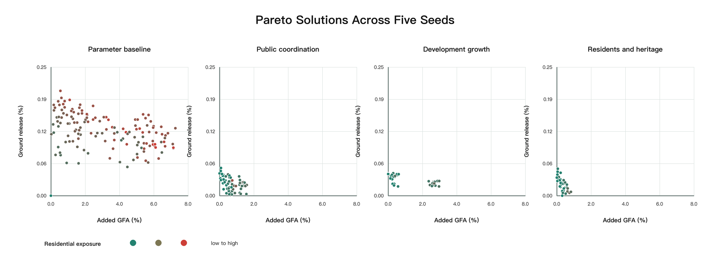
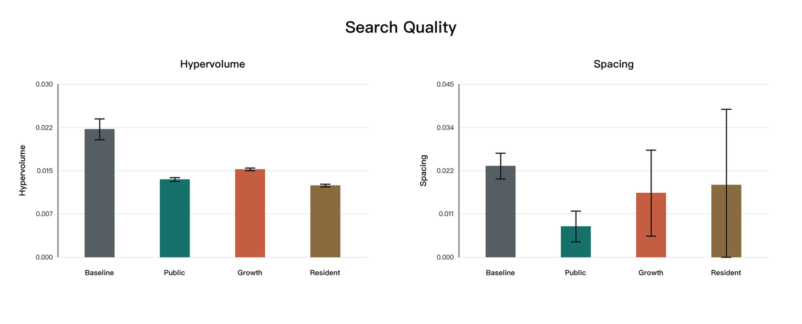
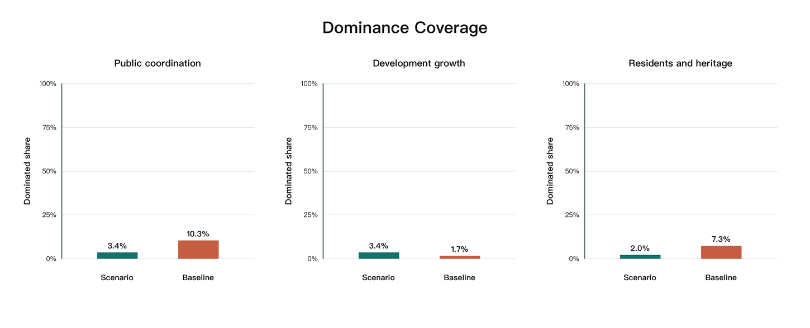

# 从利益相关者权力到城市形态：上海打浦桥城市更新的多目标生成与事后偏好框架

## 1. 摘要

历史街区更新同时涉及遗产保护、居住延续与开发利用。本文以上海打浦桥为例，将可改动对象和形态操作编码为治理情景，在共同的居住影响暴露、正向增建量和临街释放地面潜力目标下搜索 Pareto 方案，再按居民、开发实施与公共规划视角选择方案。正式实验比较传统参数基线与三个治理情景，采用五个配对种子，每方法每种子 400 次有效独立评价。基线的平均超体积为 0.0222，公共协调、开发增长及居民与遗产优先情景分别为 0.0135、0.0153 和 0.0124；三项配对比较的 Holm 校正 p 值均为 0.1875。治理情景的方案范围更受操作权限限制，但可将指标差异回溯到具体建筑和角色选择。结果表明，治理规则改变可生成的形态取舍；正向增建、街区净建筑面积变化和地面释放潜力需要分别报告。

**关键词：** 存量城市更新；遗产保护；多目标优化；利益相关者；打浦桥

## 2. 引言

历史街区更新需要同时处理建筑保护、居住改善和开发利用。增加开发容量可能涉及既有住宅的改动，释放地面空间也可能影响原有经营和日常生活。因此，更新方案的评价既涉及空间性能，也涉及收益与代价在不同主体之间的分配。在田子坊，基于实地调查的研究已将空间演变与政府、商户等行动者的权力关系联系起来，说明形态变化与空间使用和改造的权限密切相关（Wang & Zhou, 2022）。

计算设计为比较更新方案提供了工具。SIMForms 将形态生成、指标评价和可视化结合起来，场地适应布局研究则将场地条件与用户配置纳入生成规则（Zhang et al., 2024；Wang et al., 2024）。多目标优化进一步通过 Pareto 解集保留不同目标之间的折中方案，无须预先将所有目标合并为一个得分（Deb et al., 2002）。但指标上的折中不能直接回答哪些建筑可以被改动，也不能决定哪些保护要求应优先于性能收益。这些条件需要在生成之前明确。

参与式遗产规划通过共同设计和共同决策，将方案修改与选择交给参与者（Leong & Janssen, 2022）。Kaim 等（2020）则在土地利用优化中引入事后偏好，使利益相关者能够在了解目标取舍后选择方案。这些研究为连接生成与决策提供了基础，也引出本文关注的问题：如何在同一流程中，将生成前的操作权限和保护约束，与生成后的方案偏好分别表达，并追踪它们对应的空间变化。前者决定方案能否出现，后者影响参与者如何选择，两者需要在模型中区分。

上海打浦桥为研究这一问题提供了具有遗产保护背景的场地。区内田子坊保留了石库门里弄和旧厂房，并承载居住、文创商业和旅游等活动。《黄浦区田子坊地区综合管理办法》将特色建筑保护、旧厂房活化、社区微更新和商居协调纳入地区管理要求（黄浦区人民政府，2023）。在这样的街区中，更新既要维持历史空间特征，也要回应现有使用者的需求。遗产保护因而不仅影响建筑形态，还关系到哪些改变可以发生、日常生活如何延续。

本文将公共协调、开发增长、居民与遗产优先三种治理假设编码为操作权限，在共同目标下分别搜索，再以角色优先级作事后选择。正式对照另设不读取主体权限的传统参数基线。框架保留规则、评价与逐栋形态变化的记录，以支持后续参与式复核；情景和角色优先级目前均为研究假设。

**图 1.** 研究总框架。治理规则界定可生成的方案范围，角色偏好用于解释和选择所得方案。

## 3. 研究对象

### 3.1 打浦桥及其遗产保护背景

研究以上海打浦桥既有街区为对象，重点关注田子坊及周边历史空间与当代使用需求之间的关系。田子坊的里弄住宅、石库门建筑和旧厂房既构成街区的历史特征，也是居住、经营和文化活动的载体。地方管理办法将特色建筑保护与旧厂房活化利用并列提出，同时要求改善社区设施、保障房屋使用安全和协调商居关系（黄浦区人民政府，2023）。

这一背景使场地适合检验治理规则对形态生成的影响。同一种增建或地面释放操作，作用于住宅、商铺或保护对象时，所受限制和涉及的利益并不相同。本研究据此区分可改动对象与保护对象，并通过不同情景设置允许的操作范围。模型中的主体标签用于表达这些研究设定，不能直接视为现实产权或法定决策权。

### 3.2 数据与更新单元

当前数据版本包含 1,370 栋建筑、260 条街网要素、89 个公共服务对象和 38 个道路围合更新单元。其中，1,338 栋建筑关联到更新单元，另有 32 栋因空间匹配不稳定而保持现状。面积和距离均在投影坐标下计算，建筑与更新单元通过稳定标识关联。

保护数据依据黄浦区官方记录进行建筑级匹配。目前有 12 条记录对应到 21 个建筑轮廓，这些轮廓在模型中保持不变；另有 4 条记录因历史范围或现状对应不明确，暂未纳入优化约束，并保留供后续核验。上述匹配属于研究处理，尚不能替代完整的法定保护范围核验。

每个更新单元对应一组研究控制参数。更新单元由道路围合生成，不等同于法定地块。公共空间候选与非穷尽的弄堂入口资料仅作背景，不进入目标或约束；其中公共空间候选一处已核实为公园，另一处仍未核实。实验使用冻结输入，并保存文件校验信息。

**图 2.** 打浦桥研究区。卫星底图来自实验缓存的 Esri World Imagery；边界和更新单元为基于街网的研究输入，橙色为与官方记录匹配的冻结建筑轮廓，均不表示法定边界。

## 4. 方法

### 4.1 总体流程

研究流程包括输入冻结、情景设定、形态生成、约束检查、共同目标评价和方案选择（图 3）。每个情景独立搜索；所有情景使用相同的三个目标，因此所得方案可以在同一指标空间比较。角色排序在搜索结束后进行，并连接到逐栋变化记录和三维视图。

**图 3.** 总体流程。NSGA-II 反复调用形态生成与评价步骤；箭头表示主要数据传递顺序。

### 4.2 平台搭建

三维平台将规则、结果和形态记录放在同一界面。左侧依次呈现情景选择、Pareto 解选择和三维检查三个步骤；情景切换更新可选方案，角色选择在该情景的解集中定位对应方案。散点图显示三个目标的取舍，三维视图以同一卫星底图展示更新后的建筑，并可查看逐栋操作及前后属性。平台保留方案数据与导出入口，便于从指标返回具体建筑核查。平台用于研究结果阅读，界面中的角色与权限均对应本文的实验设定。

> **图 4 待插入：** 平台截图占位。使用统一视角，展示左侧三个步骤、Pareto 散点图、已选方案三维形态及建筑详情；正式排版时替换为清晰截图。

### 4.3 治理情景、形态操作与硬约束

研究设置三个治理情景。它们使用相同的输入和目标，但分别限定主体、操作许可、强度及最大改动范围（表 1）。旧版四情景已归档，不进入当前平台或本文的主比较。

| 情景 | 可行动作的侧重 | 受限对象 |
|---|---|---|
| 公共协调 | 开发主体有限增建、释放地面与高度退让；公共资产浅退界；居民院落通行改善 | 遗产与未知主体冻结 |
| 开发增长 | 开发主体增建、释放地面及大体量拆分；居民仅可低强度改善通行 | 遗产与未知主体冻结 |
| 居民与遗产优先 | 开发主体释放地面或转移高度；公共资产与居民住宅仅作低强度改善 | 遗产与未知主体冻结，住宅禁止强形态操作 |

**表 1.** 当前三情景的操作侧重；具体阈值与对象清单由配置文件保存，名称不代表现实主体已作出授权。

形态语法包括合规增建（`densify`）、释放临街地面（`open_ground`）、大体量拆分（`split_to_towers`）、敏感对象附近的高度退让（`heritage_step_down`），以及公共资产浅退界（`public_space_reconfiguration`）和居民院落窄通道（`courtyard_access_improvement`）。后两者不增加高度，仅表示候选干预。每次操作记录建筑、更新单元、操作类型、强度及前后属性。

候选方案接受九类检查：几何有效性、研究边界、保护对象不变、限高、分区容积率、覆盖率、住宅保留、新增重叠和最大改动范围。前八类构成共同检查；改动范围及情景操作权限随情景变化。算子先按约束余量调整强度，统一检查后仍违反阻断性约束的候选被淘汰。

### 4.4 评价目标

所有方案采用三个共同指标，分别衡量居住影响暴露、正向增建量和临街释放地面潜力。

居住影响暴露计入直接发生形态变化的住宅，以及与增高、拆分或退台建筑处于同一更新单元的住宅，取值越低越好：

\[
f_1 = \frac{\sum_{i \in R,\,i\ exposed} GFA_i^{base}}{\sum_{i \in R} GFA_i^{base}}
\]

其中，\(R\) 为住宅建筑集合，\(exposed\) 为上述离散暴露判定。该指标不使用距离权重，也不等同于住户搬迁或生活质量测量。

正向增建量将逐栋正建筑面积增量相加后除以研究区面积，取值越高越好：

\[
f_2 = \frac{\sum_i \max(0, GFA_i^{proposal}-GFA_i^{base})}{A_{site}}
\]

其中，\(GFA_i^{proposal}\) 为方案建筑面积，\(A_{site}\) 为研究区面积。该指标不扣减其他建筑的减量，因此必须与净 GFA 变化并列阅读。

临街地面释放潜力以原有建筑占地中被释放、且位于道路 5 米缓冲区内的面积占研究区面积的比例表示，取值越高越好：

\[
f_3 = \frac{Area[(Footprint_{base}-Footprint_{proposal}) \cap StreetBuffer_{5m}]}{A_{site}}
\]

其中，\(Footprint\) 表示建筑占地范围，\(StreetBuffer_{5m}\) 表示道路 5 米缓冲区。公共空间候选和弄堂入口不参与计算；该值既不是已形成的公共空间面积，也不表征产权或可达性。三目标的 ε 分辨率依次为 0.001、0.0005 和 0.00005；低于 1 m² GFA、1 m² 足迹且 0.1 m 高度的单体变化作为数值噪声处理。

### 4.5 多目标搜索与事后偏好

NSGA-II 对每个情景分别搜索（Deb et al., 2002）。每产生一个候选方案，程序先执行该情景许可的形态操作和约束检查，再计算三个目标。若一个方案在三个目标上均不差于另一个方案，且至少一个目标更好，则前者支配后者。搜索保留互不支配的方案；其后用统一的 ε 阈值合并指标差异很小的解，以便阅读。现状方案作为共同参照，重复形态与缓存命中不计入有效独立评价预算。

角色选择发生在每个情景的 Pareto 解集形成之后。居民视角先比较居住影响，再比较地面释放和增建；开发实施视角先比较增建；公共规划视角先比较地面释放。各视角逐级比较目标，差异在 ε 内视为同档，再看下一目标。另选取最差角色名次最低的方案作为折中解。这样，每种角色的首选解都能对应到明确的指标值和逐栋形态变化；优先级设置参考事后偏好研究（Kaim et al., 2020），仍需参与者检验。

### 4.6 实验设计

正式主实验比较一个传统参数基线与三个治理情景。四组共用冻结输入、三个目标、随机种子和有效独立评价预算；共同控制为 36 m 限高、FAR 3.0、覆盖率 0.60 和住宅 GFA 保留率 0.80。基线仅使用高度倍率 1.00–1.30 与足迹保留率 0.75–1.00，不读取主体权限；情景特定的对象许可、操作强度和更严格阈值构成被比较的治理条件。

实验使用种群 20、20 个计划代数和五个种子（11、23、37、53、71），每组每种子 400 次有效独立评价，共 20 次运行。公平性审计确认每次运行含 400 次有效评价及一个现状参照候选。报告可行率、ε-Pareto 数量、预先固定归一化边界的超体积、spacing、三目标分布、双向支配覆盖及代表解的逐栋变化；对同种子配对的超体积差异采用双侧 Wilcoxon 检验，并对三个情景的比较作 Holm 校正。五个种子的检验效力有限，因此并列报告效应方向和原始值。

正式结果及每种子 Pareto 数据保存在随文数据快照 `data/formal_three_scenario_20261004`，逐栋几何、输入及代码快照保存在同名实验输出目录。修订前的五方法归档实验使用不同情景和角色模型，不进入本次比较。

## 5. 结果

### 5.1 可行性与目标范围

四组共 20 次运行均满足相同的 400 次有效独立评价预算，且每次另含一个现状参照候选。传统参数基线的平均可行率为 99.9%，三个情景依次为 88.1%、97.8% 和 82.9%（表 2）。基线平均保留 29.6 个 ε-Pareto 解，三情景分别保留 12.0、6.4 和 6.8 个。较宽的参数变化范围对应较大的指标覆盖，治理规则则收窄可采取的形态操作。

| 方法 | 可行率（%） | ε-Pareto 解数 | 最大正向增建（%） | 最大临街释放（%） | 超体积 |
|---|---:|---:|---:|---:|---:|
| 传统参数基线 | 99.9 ± 0.1 | 29.6 ± 4.2 | 6.40 ± 1.20 | 0.178 ± 0.016 | 0.0222 ± 0.0018 |
| 公共协调 | 88.1 ± 7.6 | 12.0 ± 4.5 | 1.38 ± 0.27 | 0.0436 ± 0.0080 | 0.0135 ± 0.0003 |
| 开发增长 | 97.8 ± 2.4 | 6.4 ± 3.4 | 2.79 ± 0.17 | 0.0425 ± 0.0008 | 0.0153 ± 0.0002 |
| 居民与遗产优先 | 82.9 ± 3.0 | 6.8 ± 2.2 | 0.638 ± 0.161 | 0.0385 ± 0.0086 | 0.0124 ± 0.0002 |

**表 2.** 五种子的均值 ± 样本标准差。正向增建和临街释放以研究区面积百分比表示；超体积使用实验前固定的共同归一化边界。来源：随文 `aggregate_summary.csv`。

**图 5.** 正式对照的目标分布。各分图共用坐标范围，每个点为一个种子的 ε-Pareto 解；相同指标位置可能包含不同形态。

### 5.2 搜索质量与基线覆盖

五个配对种子中，基线的超体积均高于三个治理情景，均值差异分别为 0.0087、0.0069 和 0.0098（图 6）。三项双侧配对 Wilcoxon 检验的原始 p 值均为 0.0625，经 Holm 校正均为 0.1875；因此，本实验报告一致的效应方向，不据此声称达到常用显著性阈值。公共协调的平均 spacing 为 0.0080，低于基线的 0.0237；该指标描述解间距离的均匀性，不能单独表示方案质量。

**图 6.** 搜索质量。误差线为五种子的样本标准差；超体积越高表示共同参考范围内覆盖越大，spacing 越低表示解间距越均匀。

双向支配覆盖显示，公共协调方案平均支配基线前沿的 3.4%，基线平均支配公共协调前沿的 10.3%；开发增长对应 3.4% 与 1.7%；居民与遗产优先对应 2.0% 与 7.3%（图 7）。这些比例说明两侧均保留少量对方未覆盖的取舍。超体积和覆盖率共同表明，本次参数基线具有较广的目标范围，同时治理情景产生了少量基线未支配的方案。

**图 7.** 双向覆盖的五种子均值。“Scenario”表示情景前沿支配基线前沿的比例，“Baseline”表示反向比例。

### 5.3 角色选择与形态后果

公共协调情景的 seed 11 可展示同一 Pareto 集中的角色取舍。居民和公共规划首选解 `N_00405` 的居住暴露为 0，临街释放比例为 0.000336，正向增建比例为 0.000493；开发实施首选解 `N_00411` 对应为 0.1206、0.000205 和 0.01585。两解均满足相同硬约束，差异来自事后目标优先级。

两解也说明正向增建不等于街区净增长。`N_00405` 的正向增建约 776 m²，净 GFA 却减少约 17,730 m²；`N_00411` 的正向增建约 24,945 m²，净 GFA 增加约 7,606 m²。正向增建目标、净量和改动建筑位置应并列阅读。

> **图 8 待插入：** 公共协调 seed 11 的 `N_00405` 与 `N_00411` 并列三维形态及逐栋增减量。统一相机、比例尺和底图，并在图注列出正向增建与净 GFA。

## 6. 讨论

### 6.1 生成权限与事后偏好分处两个阶段

情景规则决定哪些建筑及动作能进入候选集；角色优先级从已经生成的 Pareto 集中选解。正式实验显示，参数基线取得更广的目标覆盖，开发增长在三个治理情景中取得最高的平均正向增建上界。两者的差异与参数基线较宽的可编辑范围及情景许可有关。公共协调 seed 11 的两个角色首选解则说明，即使治理规则相同，优先级不同也会导向不同的居住暴露、增建和净 GFA 后果。平台将这种差异连接到具体建筑，有助于讨论可接受的操作范围。

### 6.2 指标的解释边界

居住影响暴露是更新单元层面的离散代理量，不测量搬迁、噪声或生活质量。临街释放地面只测算足迹变化与道路缓冲的交集，不证明地面实际开放。正向增建与净 GFA 的背离进一步表明，单一目标极值不足以评价街区总量后果。随文数据保留净量、改动建筑及其主体分类；代表形态图仍需以统一视角补充。

### 6.3 数据和实验限制

道路围合更新单元及控制阈值为研究设定，不能替代法定控规。21 个遗产轮廓来自 12 条已匹配记录，另 4 条历史范围未决；32 栋未匹配更新单元的建筑被单独冻结。角色优先级未经过参与者验证。正式实验的五种子配对比较检验效力有限；后续需检验 ε 和情景阈值敏感性、加入算法对照，并观察参与者能否理解和修订这些规则。

## 7. 结论

本文建立了“治理规则约束生成—共同目标筛选—角色事后选择—逐栋形态追溯”的打浦桥更新框架。四方法、五种子、同预算的正式对照显示，传统参数基线覆盖更广的目标空间；三个治理情景通过可编辑对象和操作许可限制了方案范围，同时保留可追溯的角色取舍。正向增建与净 GFA 可明显分离，需与居住暴露和临街释放共同解释。下一步将补齐代表形态图，以法定资料和参与者反馈校准保护范围、操作许可与角色优先级，并扩展情景阈值和算法敏感性实验。

## 参考文献

- Deb, K., Pratap, A., Agarwal, S., & Meyarivan, T. (2002). A fast and elitist multiobjective genetic algorithm: NSGA-II. *IEEE Transactions on Evolutionary Computation*, 6(2), 182–197. <https://doi.org/10.1109/4235.996017>
- Kaim, A., Strauch, M., & Volk, M. (2020). Using Stakeholder Preferences to Identify Optimal Land Use Configurations. *Frontiers in Water*, 2, 579087. <https://doi.org/10.3389/frwa.2020.579087>
- Leong, S. L., & Janssen, P. (2022). *Participatory Planning: Heritage Conservation through Co-design and Co-decision*. Proceedings of CAADRIA 2022, Vol. 2, 505–514. <https://doi.org/10.52842/conf.caadria.2022.2.505>
- Wang, M., & Zhou, Y. (2022). The production and evolution of urban cultural and creative tourism destination from the perspective of power space: A case study of Tianzifang, Shanghai. *Geographical Research*, 41(2), 373–389. <https://doi.org/10.11821/dlyj020201265>
- Wang, Y., Hu, Q., Tang, P., Fang, R., & Meng, Y. (2024). *Urban Site Adaptive Layout Generation: User-configurable Algorithms Based on MQP*. Proceedings of CAADRIA 2024, Vol. 2, 505–514. <https://doi.org/10.52842/conf.caadria.2024.2.505>
- Zhang, B., Mo, Y., Li, B., Wang, Y., Zhang, C., & Shi, J. (2024). *SIMForms: A Web-Based Generative Application Fusing Forms, Metrics, and Visuals for Early-Stage Design*. Proceedings of CAADRIA 2024, Vol. 1, 373–382. <https://doi.org/10.52842/conf.caadria.2024.1.373>
- 黄浦区人民政府（2023）。《黄浦区田子坊地区综合管理办法》，黄府规〔2023〕3 号，2023 年 3 月 12 日施行。<https://service.shanghai.gov.cn/XingZhengWenDangKuJyh/XZGFDetails.aspx?docid=230220141250SGUTAJDzyGiwTLVshtA>
