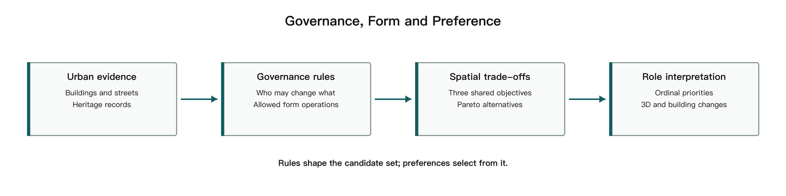
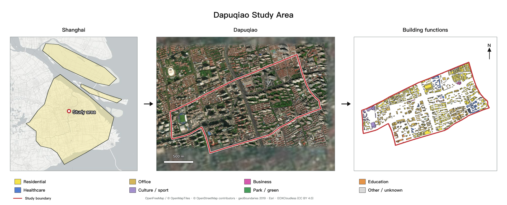
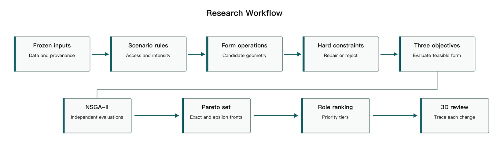
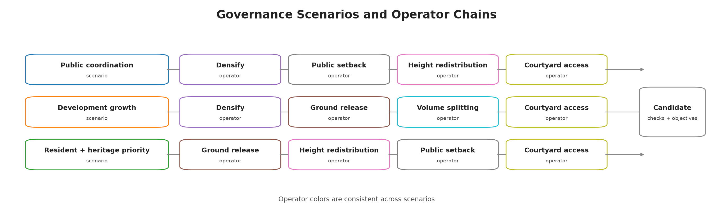
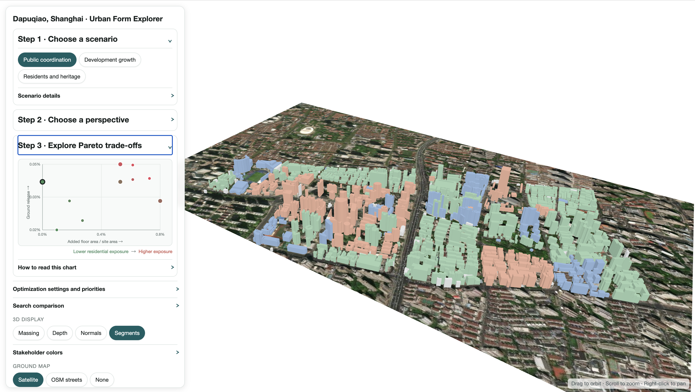
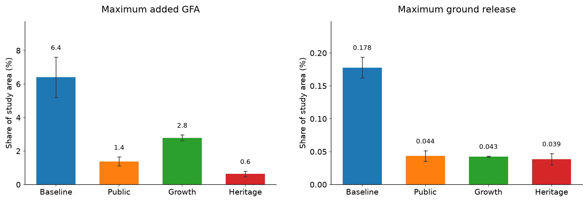

# 从利益相关者权力到城市形态：上海打浦桥城市更新的多目标生成与事后偏好框架

## 1. 摘要

历史街区更新是延续城市历史文脉、改善居民生活条件和激发既有空间活力的重要途径。这一过程需要协调遗产保护、居住改善与开发利用中的多方诉求。各方诉求如何转化为建筑改造权限，并进一步影响街区形态，是参与式规划中的关键问题。以上海打浦桥为例，本研究建立交互式形态生成与评价框架，通过治理情景（governance scenario）组合设定可改动对象、操作权限和干预强度，将公共协调、开发增长、居民与遗产优先三种更新思路落实为可执行规则。程序从现状建筑出发生成方案，检查保护与空间控制条件，并比较住宅受影响范围、新增建筑面积和临街地面释放潜力。方案生成后，再依据居民、开发实施和公共规划三种视角选择代表方案，展示逐栋建筑的变化。结果表明，治理情景通过限定可改动对象和操作方式，改变了增建容量、住宅干预与临街地面释放之间的取舍。相近的增建量可以对应不同的住宅改动规模与地面释放结果；不同角色关注的目标不同，因而会从同一组方案中选出不同结果。本文的核心创新在于，将利益主体、治理规则与空间权利转译为可执行的形态操作与约束，使不同利益分配逻辑及其对应的城市形态结果可计算、可比较、可追溯。该框架以规则驱动的方式将各方诉求映射到形态生成过程，并通过即时视觉反馈支持多方共同评估方案。结合参与式规划与计算城市设计方法，该工具可帮助规划者、设计师和社区成员理解不同更新策略的空间影响，并探索替代性方案。

**关键词：** 存量城市更新；遗产保护；多目标优化；利益相关者；参与式规划

## 2. 引言

历史街区更新需要同时处理建筑保护、居住改善和开发利用。增加开发容量可能涉及既有住宅的改动，释放地面空间也可能影响原有经营和日常生活。因此，方案评价既涉及空间利用效率，也涉及收益与代价在不同主体之间的分配。田子坊的实地研究将空间演变与政府、商户等行动者的权力关系联系起来，表明空间使用和改造权限是理解街区变化的重要线索（Wang & Zhou, 2022）。本文据此关注利益相关者权力在模型中的具体表达：哪些对象可以改动、允许怎样改动，以及不同主体如何选择方案。

计算设计为探索和比较更新方案提供了工具。SIMForms 将形态生成、指标评价和可视化结合起来，场地适应布局研究则将场地条件与用户配置纳入生成规则（Zhang et al., 2024；Wang et al., 2024）。多目标优化（multi-objective optimization）同时考察多个相互制约的目标，并保留各有得失的方案。如果一个方案在所有目标上均不差于另一方案，且至少一项目标更好，便称其支配（dominance）另一方案。由未被其他候选方案支配的方案构成的帕累托解集（Pareto set），能够呈现增建、居住影响与地面空间释放之间的取舍（Deb et al., 2002）。对历史街区而言，生成过程还需要明确建筑改动权限和保护要求，使方案探索与当地的更新条件相联系。

参与式遗产规划通过共同设计和共同决策，让参与者介入方案修改与选择（Leong & Janssen, 2022）。Kaim 等（2020）在土地利用优化中采用事后偏好（a posteriori preferences），即先生成具有不同目标取舍的方案，再根据利益相关者的偏好进行选择。这些研究引出本文的核心问题：如何在同一流程中表达生成前的操作权限和生成后的选择偏好，并追踪两者对应的空间后果？操作权限决定方案的可生成范围，选择偏好则决定参与者在这一范围内关注哪些结果。

本文以上海打浦桥为例，将三种治理情景转化为建筑改动规则，在共同目标下分别搜索方案，再依据不同角色的目标优先顺序选择代表方案。研究同时设置直接调整建筑高度和占地的参数基线（parametric baseline），作为对照方法。两类方法使用相同的城市数据、评价目标和共同约束，比较其方案范围、住宅改动和地面释放结果。研究的贡献是将“谁能改、如何改、如何选”落实为可执行、可检查的计算过程，并通过逐栋变化记录与三维展示，将总体指标连接到具体空间（图 1）。

**图 1.** 从城市数据、治理情景、形态生成和共同评价，到角色选择与空间核查的完整研究流程。每种情景各自生成帕累托方案集，每个角色均可对其排序。

## 3. 研究对象与数据

### 3.1 打浦桥的保护与更新需求

本研究选取上海打浦桥既有街区，重点关注田子坊及周边地区。田子坊的石库门里弄和旧厂房构成了街区的历史风貌，也承载着居住、商业经营和文化活动。《黄浦区田子坊地区综合管理办法》要求在保护特色建筑、活化旧厂房的同时，改善社区设施、保障房屋安全并协调商居关系（黄浦区人民政府，2023）。这些要求共同构成街区更新的治理背景。

在这样的街区中，同一项增建或地面空间释放操作，作用于住宅、商业建筑和保护建筑时，会面临不同限制，并影响不同使用者。研究因此将建筑的保护状态和主体类别纳入模型，以比较不同操作权限如何改变建筑干预的位置、方式和规模。

### 3.2 现状模型与更新单元

研究整合建筑轮廓、高度、用途、街网及保护建筑资料，建立包含 1,370 栋建筑的现状模型。道路围合形成 38 个更新单元（renewal units），作为组织形态操作和检查空间控制条件的基本范围。各单元配置相应的控制参数，建筑通过稳定标识与单元关联；未能稳定匹配的 32 栋建筑在模拟中保持现状。面积和距离统一采用投影坐标计算。

保护建筑依据黄浦区官方记录与现状建筑轮廓进行匹配。已匹配的 21 个建筑轮廓在模型中保持不变；另有 4 条记录因历史范围或现状对应关系待核验，保留在审查资料中。实验固定使用同一版本的输入数据，以保证不同方法和情景之间的可比性。

图 2 从左至右展示研究区在上海的位置、研究范围的卫星影像和建筑用途分布。用途分类依据研究数据，无法判别的归为“其他／未知”。

**图 2.** 研究区位置、范围与建筑用途

## 4. 方法

### 4.1 总体流程

框架将更新方案的形成分为生成与选择两个阶段（图 3）。生成阶段从现状模型出发，依据治理情景确定可改动建筑及其操作范围，生成候选方案；通过约束检查后，计算三个共同目标，并保留具有不同取舍的帕累托方案。选择阶段根据各角色的目标优先顺序排列方案，提取代表结果，再通过三维视图和逐栋记录检查其空间变化。

各情景独立搜索，共用同一套评价目标。这样既能观察每种治理设定内部的方案取舍，也能比较不同设定产生的空间结果。角色偏好在搜索结束后应用，参与者可以在已有解集中切换评价视角，查看同一组方案为何会得到不同排序。

**图 3.** 方案生成与选择流程。三种情景分别设定建筑操作权限，共用约束和三个评价目标；每组帕累托方案再供角色排序。

### 4.2 治理情景与形态规则

模型以主体标签（stakeholder labels）标记建筑在情景规则中对应的主体类别，并结合保护状态确定操作权限。三个治理情景分别体现公共协调、开发增长以及居民与遗产优先的更新思路，通过可改动对象、操作类型、干预强度和最大改动范围的组合形成差异（表 1）。这些组合是用于比较更新策略的研究设定。

| 情景 | 操作重点 | 主要限制 |
|---|---|---|
| 公共协调 | 开发主体有限增建、释放地面和高度退让；公共资产沿街退界；居民院落通行改善 | 保护建筑及主体类别不明的建筑保持现状 |
| 开发增长 | 开发主体增建、释放地面和大体量拆分 | 居民住宅仅允许低强度通行改善；保护建筑及主体类别不明的建筑保持现状 |
| 居民与遗产优先 | 开发主体释放地面或转移高度；公共资产与居民住宅进行低强度改善 | 限制住宅的强形态干预；保护建筑及主体类别不明的建筑保持现状 |

**表 1.** 三种治理情景的操作重点与限制

操作权限通过形态算子（morphological operators）执行。每个算子是一条改变建筑高度、占地或体量的计算规则，包含适用对象、变化方式和操作强度。六种算子覆盖增建、占地收缩、体量拆分、高度调整以及通行空间改善（表 2）。例如，释放地面算子先收缩建筑占地，再在限高和容量允许的范围内增加高度，以补偿部分建筑面积；同一操作由此可能同时影响地面空间与周边住宅。

| 形态算子 | 建筑变化 | 主要控制条件 |
|---|---|---|
| 合规增建（densification） | 保持占地，增加建筑高度 | 最大增高比例为 30%，同时受限高和单元剩余容量约束 |
| 释放地面（ground release） | 收缩占地，并尝试通过增高补偿建筑面积 | 最大占地收缩比例为 25%，补偿高度受限高约束 |
| 大体量拆分（volume splitting） | 在建筑中部切出间隙，并尝试增加高度补偿面积 | 适用于占地至少 300 m² 的建筑，间隙随操作强度变化 |
| 敏感对象退让（height redistribution） | 在同一单元内降低住宅及遗产附近建筑的高度，并向较远处转移 | 调整后仍需满足限高及单元容量约束 |
| 公共资产浅退界（public-asset setback） | 收缩公共资产建筑的临街占地，保持高度 | 沿街最多退让 4 m |
| 居民院落通行改善（courtyard access improvement） | 从临街侧向院落切出候选通道，保持高度 | 通道最宽 3 m |

**表 2.** 六种形态算子的变化方式与控制条件；实际变化由操作强度、原始轮廓和约束余量共同确定。

**图 4.** 治理情景与形态算子链。箭头表示情景规则中算子的主要执行顺序，实际搜索仍会根据单元条件和约束余量调整操作强度。

生成后的方案须满足硬约束（hard constraints），即决定方案能否进入后续比较的必要条件。检查涵盖几何有效性、研究边界、保护对象不变、限高、单元容积率、建筑覆盖率、住宅保留、新增重叠和最大改动范围。其中，容积率（floor area ratio，FAR）为单元内总建筑面积与单元面积之比，建筑覆盖率（building coverage ratio）为建筑占地与单元面积之比。前八项检查由各方法共用，最大改动范围及操作权限随情景设定。程序先依据约束余量调整操作强度，再统一检查候选方案，淘汰仍违反条件的结果。每次操作均保存建筑编号、所属单元、操作类型、强度及前后属性，供后续追踪。

### 4.3 三个共同评价目标

三个目标分别描述住宅受影响的范围、新增建筑面积和临街地面释放潜力。为便于跨方案比较，各指标均按相应的基准面积归一化。总建筑面积（gross floor area，GFA）用于计算住宅规模及建筑面积变化。

**居住影响暴露（residential impact exposure）**衡量可能受到形态变化影响的住宅建筑面积比例，取值越低越好。模型将直接发生改动的住宅，以及与增高、拆分或退台建筑处于同一更新单元的住宅，计入受影响范围：

\[
f_1 = \frac{\sum_{i \in R,\,i\ exposed} GFA_i^{base}}{\sum_{i \in R} GFA_i^{base}}
\]

其中，\(R\) 为住宅建筑集合，\(GFA_i^{base}\) 为建筑 \(i\) 的现状总建筑面积，\(exposed\) 表示满足上述条件。以更新单元识别间接影响，可以将干预周边住宅纳入评价；因此，直接改动的住宅较少时，暴露值仍可能较高。

**正向增建量（positive floor-area addition）**累计各建筑增加的建筑面积，并除以研究区面积，取值越高越好：

\[
f_2 = \frac{\sum_i \max(0, GFA_i^{proposal}-GFA_i^{base})}{A_{site}}
\]

其中，\(GFA_i^{proposal}\) 为方案总建筑面积，\(A_{site}\) 为研究区面积。该指标反映方案提供新增容量的能力。结果分析同时报告净建筑面积变化，即增加量与减少量的合计，以说明新增容量是否伴随其他位置的拆减。

**临街地面释放潜力（street-adjacent ground-release potential）**衡量建筑占地收缩后，在道路附近形成的地面空间，取值越高越好：

\[
f_3 = \frac{Area[(Footprint_{base}-Footprint_{proposal}) \cap StreetBuffer_{5m}]}{A_{site}}
\]

其中，\(Footprint\) 为建筑占地范围，\(StreetBuffer_{5m}\) 为道路两侧的 5 m 缓冲范围。指标提取现状占地与方案占地之差，再计算其中落入道路缓冲区的面积，因而侧重反映与街道相邻的空间释放机会。

### 4.4 多目标搜索与角色选择

研究采用非支配排序遗传算法 II（Non-dominated Sorting Genetic Algorithm II，NSGA-II）搜索方案（Deb et al., 2002）。算法从一组候选方案出发，通过反复生成、评价和筛选，逐步保留具有不同目标取舍的结果。每个候选都经过情景操作、约束检查和三目标计算；现状方案作为共同参照。搜索结束后，采用容差阈值（epsilon tolerance）合并指标差异很小的方案，使解集更便于比较。

角色选择采用按优先顺序逐项比较的排序方式。当一项目标的差异处于容差范围内时，继续比较下一项目标。三种角色的比较顺序如下：

| 角色 | 第 1 优先级 | 第 2 优先级 | 第 3 优先级 |
|---|---|---|---|
| 居民 | 居住影响暴露（越低越好） | 正向增建量（越高越好） | 临街地面释放（越高越好） |
| 开发实施 | 正向增建量（越高越好） | 临街地面释放（越高越好） | 居住影响暴露（越低越好） |
| 公共规划 | 临街地面释放（越高越好） | 居住影响暴露（越低越好） | 正向增建量（越高越好） |

**表 3.** 三种角色的逐级目标排序。目标差异小于对应的 ε 容差时，进入下一优先级比较。优先顺序借鉴事后偏好研究（Kaim et al., 2020）。

框架还提供兼顾各角色的折中方案：先记录每个方案在不同角色排序中的名次，再选出其中最差名次最靠前的方案。这一选择方式优先改善方案在最不利角色排序中的位置，为多方比较提供共同起点。

### 4.5 对照实验设计

实验比较参数基线与三个治理情景。参数基线通过高度倍率 1.00–1.30 和占地保留比例 0.75–1.00 调整建筑；治理情景采用表 1 和表 2 中的对象权限与形态操作。四组共用输入数据、三个目标和共同约束，统一设置 36 m 限高、容积率 3.0、建筑覆盖率 0.60 和住宅总建筑面积最低保留比例 0.80。

每组采用 20 个个体的种群、20 个计划代数，并以五个相同的随机种子配对运行。随机种子（random seed）控制随机过程，便于复现和对应比较。每次运行完成 400 次有效独立评价，即实际计算互不重复的候选形态；重复方案直接调用已有结果。四组共形成 20 次运行，并保存输入、参数、逐栋变化和结果记录。

分析分为三个层次：首先比较各方法的目标范围；其次选取增建量相近的方案，检查住宅改动与地面释放的差异；最后在同一情景中比较不同角色选择的空间后果。目标范围另以超体积（hypervolume）辅助评价，该指标衡量解集相对于统一参考点所覆盖的目标空间。五个种子的超体积采用双侧配对符号秩检验（Wilcoxon signed-rank test），依据配对差值的方向和排序比较两组结果；再以 Holm 校正（Holm correction）调整三次比较的 p 值，控制多重比较的误判概率。

### 4.6 交互平台

平台将情景选择、角色选择和方案探索组织为连续的操作步骤。用户选择情景后，可在目标散点图中查看方案取舍，选择角色后查看对应排序，再点击方案联动显示三维形态和建筑详情。逐栋记录呈现操作前后的高度、占地与建筑面积，使总体指标能够追溯到具体改动。

设置面板允许调整情景参数并重新计算。每次运行独立保存参数与结果，完成后刷新方案及三维视图。用户由此可以检查某项权限或强度变化如何影响可选方案，并据此继续修订更新设定。

**图 5.** 交互平台界面
## 5. 结果

### 5.1 总体结果与方案范围

四种生成方法均在相同输入、目标和硬约束下运行五次。表 4 汇总各方法在五次运行中达到的最大正向增建量和最大临街地面释放量；图 6 将两个最大值并列展示，图 7 则把正向增建、临街地面释放和居住影响暴露放在同一方案分布中比较。正向增建量表示方案增加的建筑面积占研究区面积的比例，临街释放量表示道路缓冲区内减少的建筑占地面积占研究区面积的比例。图 7 中每个点代表一个帕累托方案，颜色表示居住影响暴露。

| 方法 | 最大正向增建（%） | 最大临街释放（%） |
|---|---:|---:|
| 参数基线 | 6.40 ± 1.20 | 0.178 ± 0.016 |
| 公共协调 | 1.38 ± 0.27 | 0.0436 ± 0.0080 |
| 开发增长 | 2.79 ± 0.17 | 0.0425 ± 0.0008 |
| 居民与遗产优先 | 0.638 ± 0.161 | 0.0385 ± 0.0086 |

**表 4.** 五次运行中各方法目标最大值的均值 ± 标准差。两列最大值分别来自各自目标值最高的方案。

**图 6.** 各方法的增建与临街地面释放规模，误差线为标准差。左右两图采用独立纵轴刻度。

**图 7.** 四种方法的帕累托方案分布。横轴为正向增建，纵轴为临街释放，颜色表示居住影响暴露；各分图采用独立坐标范围。

参数基线的方案分布覆盖范围最大，三个治理情景的方案集中在较小的增建和临街释放区间。开发增长的最大正向增建量高于公共协调和居民与遗产优先；三个治理情景的最大临街释放量接近。部分治理情景方案未被参数基线支配。三组情景与基线的超体积配对检验经校正后的 \(p\) 值均为 0.1875。

### 5.2 三种治理情景的方案特征

三个治理情景使用同一套输入、目标和硬约束，通过改变可改动对象、形态算子和操作强度形成不同的方案范围。表 5 汇总各情景的操作重点和目标范围；图 7 展示这些方案在正向增建、临街地面释放和居住影响三个目标上的分布。

| 情景 | 操作重点 | 最大正向增建（%） | 最大临街释放（%） |
|---|---|---:|---:|---|
| 公共协调 | 开发主体有限增建；公共资产沿街退界；居民低强度院落通行改善 | 1.38 ± 0.27 | 0.0436 ± 0.0080 |
| 开发增长 | 开发主体增建、释放地面和大体量拆分；居民低强度通行改善 | 2.79 ± 0.17 | 0.0425 ± 0.0008 |
| 居民与遗产优先 | 开发主体释放地面或转移高度；公共资产和居民低强度改善 | 0.638 ± 0.161 | 0.0385 ± 0.0086 |

**表 5.** 三种治理情景的操作重点和目标最大值。最大值为五次运行的均值 ± 标准差。

公共协调情景在开发增建、公共资产退界和居民通行改善之间保持平衡，最大正向增建量为 1.38%，最大临街释放量为 0.0436%。其代表性角色选择见 5.3 节，方案编号仅用于标识公共协调情景随机种子 11 中的结果。

开发增长情景把更多增建和体量拆分操作交给开发主体，最大正向增建量达到 2.79%，为三个治理情景中最高；最大临街释放量为 0.0425%，与公共协调接近。该情景的方案分布覆盖更高的新增容量区间，具体代表方案应根据开发增长情景自身的结果文件读取。

居民与遗产优先情景限制住宅的强形态操作，主要通过释放地面、转移高度和低强度改善形成方案。其最大正向增建量为 0.638%，三个治理情景中最低；最大临街释放量为 0.0385%。该情景的方案集中在较低新增容量区间，住宅暴露受到更严格的控制，具体的建筑变化由逐栋操作记录呈现。

### 5.3 三种情景下的角色选择

角色排序在各情景的帕累托方案形成后进行。居民视角依次比较居住影响、正向增建量和临街地面释放；开发实施视角依次比较正向增建量、临街地面释放和居住影响；公共规划视角依次比较临街地面释放、居住影响和正向增建量。表 6 汇总随机种子 11 中三种情景的角色首选方案。方案编号只在所属情景和随机种子内有效。

| 情景 | 角色 | 方案编号 | 居住影响暴露（%） | 正向增建量（m²） | 临街释放占研究区面积（%） | 净建筑面积变化（m²） |
|---|---|---|---:|---:|---:|---:|
| 公共协调 | 居民 | `N_00385` | 0 | 3,090 | 0.0242 | −21,417 |
| 公共协调 | 开发实施 | `N_00411` | 12.1 | 24,945 | 0.0205 | +7,606 |
| 公共协调 | 公共规划 | `N_00405` | 0 | 776 | 0.0336 | −17,730 |
| 开发增长 | 居民 | `N_00362` | 0 | 4,453 | 0.0420 | −37,797 |
| 开发增长 | 开发实施 | `N_00394` | 15.0 | 41,428 | 0.0268 | +12,488 |
| 开发增长 | 公共规划 | `N_00362` | 0 | 4,453 | 0.0420 | −37,797 |
| 居民与遗产优先 | 居民 | `N_00383` | 0.045 | 4,170 | 0.0256 | −24,795 |
| 居民与遗产优先 | 开发实施 | `N_00269` | 4.58 | 9,300 | 0.0216 | −23,028 |
| 居民与遗产优先 | 公共规划 | `N_00252` | 0.045 | 1,080 | 0.0338 | −24,979 |

**表 6.** 三种治理情景、随机种子 11 的角色首选方案。角色排序依据方法部分的目标优先顺序；面积数值四舍五入，正负号表示净增加或净减少。

在本次运行中，公共协调和居民与遗产优先情景下，居民与公共规划视角选出了不同方案：两者的居住影响暴露相同，居民首选方案的新增容量较高，公共规划首选方案的临街地面释放较多。开发增长情景下，两种视角仍选中同一方案。三个情景中，开发实施首选方案均提供了更多新增建筑面积，同时伴随更高的居住影响暴露。

## 6. 讨论

### 6.1 治理规则进入形态生成

本文把利益主体、治理规则和空间权利转化为可执行的形态操作。传统参数方法直接调整高度和占地；本研究进一步规定“哪些对象可以改、可以使用哪些算子、操作强度是多少”，再将这些规则送入同一套多目标搜索。结果表明，规则组合会改变方案的增建范围、临街地面释放和住宅影响分布。治理情景因此成为连接制度设定与空间结果的中间层，参与者可以从总体指标追溯到具体建筑和操作记录。

这一表达方式也改变了更新方案的比较单位。方案不再只以总建筑面积或单项性能排序，还可以按照改动对象、操作类型和住宅暴露范围进行检查。公共协调、开发增长和居民与遗产优先的差异，说明同一街区可以通过不同的权限配置形成不同的空间取舍。后续研究可以逐项改变主体许可、算子组合和强度阈值，观察某一条规则对结果的独立影响，并据此校准更适合当地条件的规则集。

### 6.2 从方案选择延伸到协商过程

在此基础上，框架把生成和选择分成两个阶段。治理情景先确定可探索的方案范围，角色排序再从同一组帕累托方案中选择结果。表 6 显示，居民视角在住宅影响相同或接近的方案中继续偏向保留更多新增容量，公共规划视角优先选择临街地面释放更大的方案，开发实施视角优先选择新增容量更高的方案；当某一情景的帕累托前沿只有一个方案同时满足多个优先目标时，角色仍可能选中同一方案。这个过程使目标冲突能够通过方案对照呈现，便于参与者讨论“优先保护什么、允许谁承担改动、哪些收益值得交换”。

三维视图、指标散点和逐栋日志可以组成一个可反复调整的协商界面。参与者可以先比较方案，再修改角色优先顺序或治理参数，重新观察空间结果。后续可在工作坊中邀请居民、经营者、规划者和保护相关人员共同校准主体标签、操作权限和评价顺序，记录他们如何理解方案并修改规则。这样，计算模型可以从研究者设定的比较工具，进一步发展为支持多方共同修订的设计工具。

### 6.3 研究范围与后续验证

当前实验将多项权限和操作组合为整体生成方式进行比较。后续可扩大随机重复次数，检验方案范围和容差设置的稳定性，并逐项开展规则敏感性实验。模型采用道路围合单元和研究控制参数组织计算，实际应用时需与法定地块及控规资料对接；保护范围尚待核验的记录也需进一步完成建筑级匹配。

三个评价指标分别对应模型中的住宅暴露、新增容量和临街释放面积。对生活质量的判断需要住户调查，对公共空间使用的判断需要产权、通达性和管理条件资料。将这些证据与空间结果结合，可以检验模型生成的取舍是否符合实际更新需求。

## 7. 结论

本文建立了连接治理规则、形态生成、多目标评价与角色选择的打浦桥街区更新框架。框架将建筑改动权限转化为可执行的形态规则，并通过逐栋记录和三维展示说明规则的空间后果。

对照实验表明，参数基线具有较广的方案范围，治理情景则通过对象和操作限制形成不同的干预分布。相近的增建量可以对应明显不同的住宅改动规模与临街地面释放结果；同一组可行方案也会因角色优先顺序不同而产生不同选择。研究由此为多方协商提供了从规则到方案、从指标到建筑的比较路径，后续将结合规划资料核验与参与者反馈完善其应用。

## 参考文献

- Deb, K., Pratap, A., Agarwal, S., & Meyarivan, T. (2002). A fast and elitist multiobjective genetic algorithm: NSGA-II. *IEEE Transactions on Evolutionary Computation*, 6(2), 182–197. <https://doi.org/10.1109/4235.996017>
- Kaim, A., Strauch, M., & Volk, M. (2020). Using Stakeholder Preferences to Identify Optimal Land Use Configurations. *Frontiers in Water*, 2, 579087. <https://doi.org/10.3389/frwa.2020.579087>
- Leong, S. L., & Janssen, P. (2022). *Participatory Planning: Heritage Conservation through Co-design and Co-decision*. Proceedings of CAADRIA 2022, Vol. 2, 505–514. <https://doi.org/10.52842/conf.caadria.2022.2.505>
- Wang, M., & Zhou, Y. (2022). The production and evolution of urban cultural and creative tourism destination from the perspective of power space: A case study of Tianzifang, Shanghai. *Geographical Research*, 41(2), 373–389. <https://doi.org/10.11821/dlyj020201265>
- Wang, Y., Hu, Q., Tang, P., Fang, R., & Meng, Y. (2024). *Urban Site Adaptive Layout Generation: User-configurable Algorithms Based on MQP*. Proceedings of CAADRIA 2024, Vol. 2, 505–514. <https://doi.org/10.52842/conf.caadria.2024.2.505>
- Zhang, B., Mo, Y., Li, B., Wang, Y., Zhang, C., & Shi, J. (2024). *SIMForms: A Web-Based Generative Application Fusing Forms, Metrics, and Visuals for Early-Stage Design*. Proceedings of CAADRIA 2024, Vol. 1, 373–382. <https://doi.org/10.52842/conf.caadria.2024.1.373>
- OpenStreetMap contributors. *OpenStreetMap data*. <https://www.openstreetmap.org/copyright>
- OpenFreeMap. *Positron map style*（© OpenMapTiles，数据来自 OpenStreetMap）. <https://openfreemap.org/>
- geoBoundaries. *China ADM1, Shanghai Municipality, gbOpen, 2019*. <https://www.geoboundaries.org/api/current/gbOpen/CHN/ADM1/>
- Esri. *World Imagery*（含影像供应方与 GIS User Community 贡献）. <https://www.arcgis.com/home/item.html?id=10df2279f9684e4a9f6a7f08febac2a9>
- EOX IT Services GmbH. *Sentinel-2 cloudless 2016 imagery*（含改编的 Copernicus Sentinel 数据，CC BY 4.0）. <https://cloudless.eox.at/license-non-commercial>
- 黄浦区人民政府（2023）。《黄浦区田子坊地区综合管理办法》，黄府规〔2023〕3 号，2023 年 3 月 12 日施行。<https://service.shanghai.gov.cn/XingZhengWenDangKuJyh/XZGFDetails.aspx?docid=230220141250SGUTAJDzyGiwTLVshtA>
